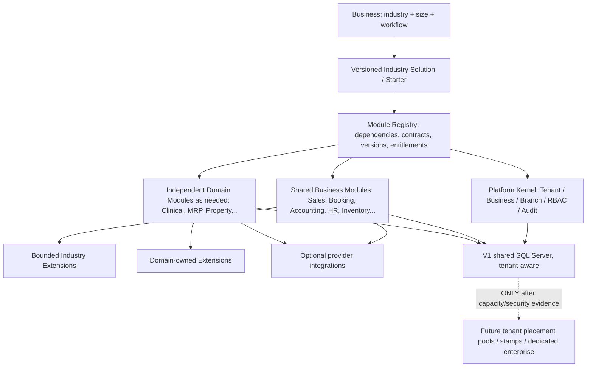

# DRVO ERP — Founder Architecture Charter / دستور المشروع المعماري

**Founder statement:** 2026-10-30
**Status:** FOUNDER-APPROVED PRODUCT MISSION AND NON-NEGOTIABLE ARCHITECTURAL DIRECTION. Technical readiness is NOT proven; Phase 0 documentation only.
**Authority:** This is the **first design authority** new engineering contributors, Cursor/Codex agents, product designers and future architects must read. It guides — does not silently supersede — existing accepted ADRs. Any conflict requires a proposed ADR and explicit founder review, not an undocumented workaround.

> **DRVO ERP aspires to become one of the largest ERP platforms in Egypt: one extensible product foundation capable of being expanded to new industries and appropriately scaled from the smallest business to the very largest enterprises, without rebuilding or forking the ERP for each customer.**
>
> **العربي:** هدف DRVO ERP أن يصبح من أكبر منصات ERP في مصر؛ بنواة واحدة قابلة لاستيعاب أنشطة اقتصادية جديدة وبناء Modules وExtensions لها، وبنمو تشغيلي يناسب الأعمال الصغيرة جدًا حتى المؤسسات الضخمة، دون نسخ نظام مستقل لكل عميل.

**Important:** This is a long-term design mission, not a claim to current market rank, proven universal regulatory compatibility, infinite traffic capacity, or existing readiness for every company. No honest architecture can promise “100% certain” scalability before modeling, testing and real operating evidence.

## 1. Three immutable strategic pillars

### PILLAR I — Egypt-scale national ERP platform
- Build **a reusable multi-tenant SaaS product**, not a collection of contract projects, one-off customer forks or Salon-only code.
- Preserve a single coherent DRVO Platform Kernel: Tenant/Business/Branch identity, RBAC, subscription/entitlement, module/version registry, auditing, business-scoped configuration and trustworthy financial controls.
- Design for onboarding, supportability, security, observability, compliant billing, evolution/versioning and recoverability so customer and industry growth does not require a new product each time.
- Marketplace/catalog, industry ecosystem and operations Control Center must scale separately from active Module tiles seen by each Business.
- **Product ambition vs technical proof:** large customer counts require measured capacity/SLOs, operational processes, engineering team and budget. Market leadership is a business outcome, not an architectural guarantee.

### PILLAR II — Any business type can be addressed by repeatable industry extension
- **Shared Business Modules** own stable common invariants and lifecycles (e.g., POS/Sales, Treasury/Accounting, Booking, HR, Inventory).
- Every Module has documented **Core + Extension** contracts (ADR-006); a bounded **Industry Extension** modifies stable behavior without embedding a growing number of arbitrary industry switches inside Core.
- An independent **Domain Module** with its own Core/Extensions is created **when** a different aggregate, state machine, sensitive data boundary, financial invariant, or operational lifecycle warrants it (ADR-019). Do not create one pointless mandatory module per industry; do not shove medical records or MRP into Booking.
- **Industry Solution** is a versioned, customizable composition of released modules, extensions, role/configuration templates and integrations, not a per-industry fork, dynamically executed customer code or a giant sole app.
- Onboarding a NEW industry follows Discovery → Fit/Gap → Domain/Compliance analysis → boundary decisions → build/integration → QA → productization, with reusable artifacts and published support limitations (ADR-018).
- Public website may later cover many industry categories, but do **not** claim unsupported sectors work without actual validated Modules, legal readiness and tested workflows.

### PILLAR III — From tiny business to very large enterprise
There are **two separate forms of scalability**, BOTH required:
1. **Functional/commercial scale — Module Composition:** each Business starts from the smallest **valid** industry/workflow solution, includes mandatory dependencies and finance/security invariants, and activates more optional modules, branches, seats, integrations and capabilities as needed. No forced full-ERP training or expense for a tiny customer. Activation is per Business, has compatibility controls and a full cost preview/consent (ADRs 016/020/021). Historical records and ledgers are preserved when upgrading/downgrading.
2. **Technical/operational scale — Infrastructure and Correctness:** a large Business/large Tenant may require more users, branches, devices, writes, storage, integrations, privacy, support, availability, concurrency, reporting workload, data migration and recovery. More Modules alone **do not** increase database throughput, protect against noisy-neighbor load or give an SLA. Architect a measured path from V1 shared tenant-aware SQL Server/modular monolith to scaled workers, optimized queries, tenant placement pools/stamps and potentially dedicated enterprise deployment — only where tests and requirements justify it.

**Explicit rule:** Never equate “Small uses 3 Modules, Enterprise uses 30 Modules” with validated scale readiness. Both could use 3 Modules and have workloads differing by orders of magnitude.

## 2. Non-negotiable architecture guardrails
1. **One shared product codebase; Modular Monolith first** with enforceable bounded contexts. Deploying a module and enabling it for one Business are separate operations. Future service extraction is optional, measured and contract-preserving.
2. **Multi-Tenant isolation by construction:** Tenant/Business/Branch scope flows through identities, storage, APIs, jobs, cache, event envelopes, audit, search, reports and UI; strong RBAC server-side, immutable financial traceability.
3. **Single accountable source of truth per domain:** other Modules consume explicit typed/versioned contracts or domain events, not direct writes into another Module's tables. Cross-domain transactions and consistency clearly specified; critical financial posting idempotent.
4. **Core+Extension for EVERY Module** (ADR-006), but no useless generated placeholders. Extension contract permits compatible policy variation, not arbitrary unreviewed runtime code.
5. **Industry Domains are conditional:** distinguish Shared Core vs Extension vs independent Domain Module vs Integration based on invariants/lifecycle/security, not customer name or UI label.
6. **Business activation is progressive, reversible within safe limits:** required dependency closure, compatibility, explicit pricing/one approval, preserved posted history, read rights and data retention even if an add-on becomes inactive.
7. **Evolution without lock-in:** versioned module/industry manifests, data schema migrations, backfills, deprecation policy, event/version compatibility, controlled rollouts, rollback/recovery and realistic data export/tenant movement path.
8. **Security/regulation and financial integrity never optional:** customer choice of starter, palette, roles or subscription cannot remove legally or financially mandatory controls. Clinic privacy, Egyptian/Gulf taxation and jurisdiction requirements must be validated per sector/market.
9. **Performance and observability are essential design dimensions:** isolate heavy reporting/AI/integrations from POS latency where possible; instrument tenant-specific load, slow queries, job queues, capacity and incidents.
10. **Data placement readiness before extreme growth:** initial one shared SQL Server/VPS is a starting point, **not** a universal enterprise SLA. Abstract data ownership/tenant placement and migration contracts enough to permit future isolated pools/stamps without premature microservices.
11. **One coherent, accessible UX:** Odoo-grade ERP capability with Duolingo-inspired clarity, DRVO original UI Kit; validated per-Business palettes/fonts and optional industry illustration do not fork function or weaken status truth (ADRs 022–028).
12. **No unsupported marketing claim:** explicitly show supported industries, countries, integrations, limits, deployment tier, data safeguards and tested capacity. Never promise all industries/enterprise sizes today.

## 3. Reference composition / future scaling map (conceptual only)

The chart does NOT claim every industry/domain module already exists, or that modules automatically map to separate databases. Industry Starter is a composition, NOT a security boundary. Data ownership and transport are defined in component contracts and enforced by the runtime.

## 4. Three-customer architectural acceptance lenses

| Customer size | Example demand | Functional assembly | Scale evidence additionally required |
|---|---|---|---|
| **Micro** | Single barber/retailer, 1 location, small staff | Only minimum **valid** POS/Booking/Accounting security set for selected workflow; add advanced features later | fast setup/operation, transparent fee, safe finance, no unused complexity |
| **Growing SME** | Salon network or distributor, several branches | Extra Branch config, inventory, HR/Payroll, approvals, advanced reporting/optional integrations | branch isolation, concurrent operators, multi-branch ledger accuracy, import volume, worker/backups |
| **Large Enterprise** | Manufacturer, national trade company, health group | Specialized MRP/clinical/operations Domain Modules, complex roles, integration, multi-Business workflow | load/capacity proof, tenant isolation under stress, HA/DR/RPO/RTO, data residency/regulation, support/SLA and migration/placement plan |

These are **validation scenarios, not supported plan tiers or promises**. The small customer may be transaction-heavy and the large customer may need fewer Modules — capacity must be modeled from real workload.

## 5. Founder decision test — mandatory for ALL future ADRs, modules, pricing, UX and infrastructure
Before approving any architecture change, document:
1. **Pillar I:** Does it build a reusable DRVO capability, or a one-customer/one-industry fork? How will it be run and supported at scale?
2. **Pillar II:** Can a future unrelated industry reuse its invariant? If not, is the difference a bounded Extension or independent domain? Are contracts and schema/version transitions explicit?
3. **Pillar III:** Can a micro Business avoid unwanted complexity without bypassing mandatory controls? What changes under huge enterprise load? How is that scaling path tested?
4. **Tenancy/correctness:** Are Tenant/Business/Branch, RBAC, ledger and financial idempotency preserved across all Modules and all deployments?
5. **Evolution:** Can customer modules be activated/disabled/upgraded without data loss, surprise price or incompatible cascade? Can the data placement evolve?
6. **Evidence:** Which tests and measurable limits demonstrate actual industry fit and capacity? What remains open? Who signs off?
7. **Decision:** document PASS / NEEDS DESIGN / BLOCKED with links to applicable ADRs and owner. Unproven claims cannot pass by assertion.

**Blocking rule:** A solution that hardcodes an industry/customer fork, requires every company to activate all modules, or irreversibly ties all tenants to one unscalable data access pattern violates this charter unless the founder explicitly approves an exception via a new ADR, with reason and migration/exit plan.

## 6. Stage and roadmap reality
- **NOW:** Phase 0, architecture/docs, no app code, no test results, no enterprise load evidence.
- **First:** Salon/Cut Salon pilot, comprehensive Salon platform with configurable minimum valid Business starter; **no standalone Salon Service Execution V1** under ADR-020.
- **Second:** Clinic after regulated medical/sensitive-data domain/compliance work.
- **Later:** Education, Real Estate, manufacturing and other industries via repeatable fit-gap and productization; not launch promises.
- **Infrastructure baseline:** Modular Monolith + tenant-aware shared SQL Server on VPS initially, with measurable expansion path, not prematurely built dedicated DBs/microservices.
- **Commercial:** Business plans/pricing and actual support tiers remain undecided; do not presume unlimited features/capacity.
- **Implementation:** Founder has NOT authorized product code/schema deployment. Future implementation requires explicit permission after pre-code gates.

## 7. Document authority / handoff protocol
1. **Read this Charter FIRST**, followed by [Vision](../01-product/VISION.md), [Architecture](../02-architecture/ARCHITECTURE.md), [ADR Register](../05-decisions/DECISIONS.md), [Scale Fitness Gates](../02-architecture/UNIVERSAL-ERP-SCALE-AND-INDUSTRY-FITNESS-GATES.md), [Current State](CURRENT-STATE.md).
2. This Charter defines **strategic guardrails**, not approved technical specs where ADRs are still open.
3. A later conflicting design must state which pillar is affected and be escalated to founder in a versioned ADR; never silently weaken this foundation to ship a quick feature.
4. All new Module specs, Industry onboarding playbooks, technical architecture proposals, pricing tiers, enterprise deployment promises and Cursor plans must include the seven-question architectural fit assessment.
5. Mark designs as PROPOSED / ACCEPTED DIRECTION / VERIFIED IN IMPLEMENTATION / PRODUCTION READINESS separately, with evidence.

[ADR-029 — Three-Pillar Architecture Mission](../05-decisions/ADR-029-THREE-PILLAR-UNIVERSAL-ERP-ARCHITECTURE.md) · [Industry Architecture](../02-architecture/INDUSTRY-SOLUTIONS-ARCHITECTURE.md) · [Scale Strategy](../02-architecture/SAAS-SCALE-CATALOG-AND-CONTROL-CENTER.md).

**This Charter governs future work. It is NOT a claim of a completed system or a license to start coding.**

## How this Charter is applied — founder scope confirmation 2026-10-30

The Charter remains the **supreme WHY** (Egypt-scale ambition, any-industry expansion, every business size). Founder clarified Phase-0 should focus on **universal architecture laws rather than predesigning the technical internals of individual Modules**. The canonical short platform-wide HOW is the [DRVO Core Architecture Constitution](DRVO-CORE-ARCHITECTURE-CONSTITUTION.md). For daily work: read Charter → Constitution → accepted ADR register → task-specific detail only when justified. Previously authored financial/Module Activation design drafts remain archived as future reference **without claiming implementation adoption**; accepted founder product decisions are not repealed. No code authorized.

## Founder-approved Business independence from Industry — ADR-033 (2026-10-30)

The Charter's any-industry ambition now has an explicit accepted platform rule: [ADR-033](../05-decisions/ADR-033-BUSINESS-IDENTITY-INDEPENDENT-OF-INDUSTRY.md) confirms **Business ≠ Industry**. One Business can compose multiple compatible activities/Modules/Extensions without a duplicate codebase or mandatory second Business; real legal/financial entities remain separated as appropriate. Three other Constitution-level policy questions remain pending: [Founder Decision Brief](../02-architecture/CORE-CONSTITUTION-REMAINING-FOUNDATION-POLICIES.md). No implementation authorization.
