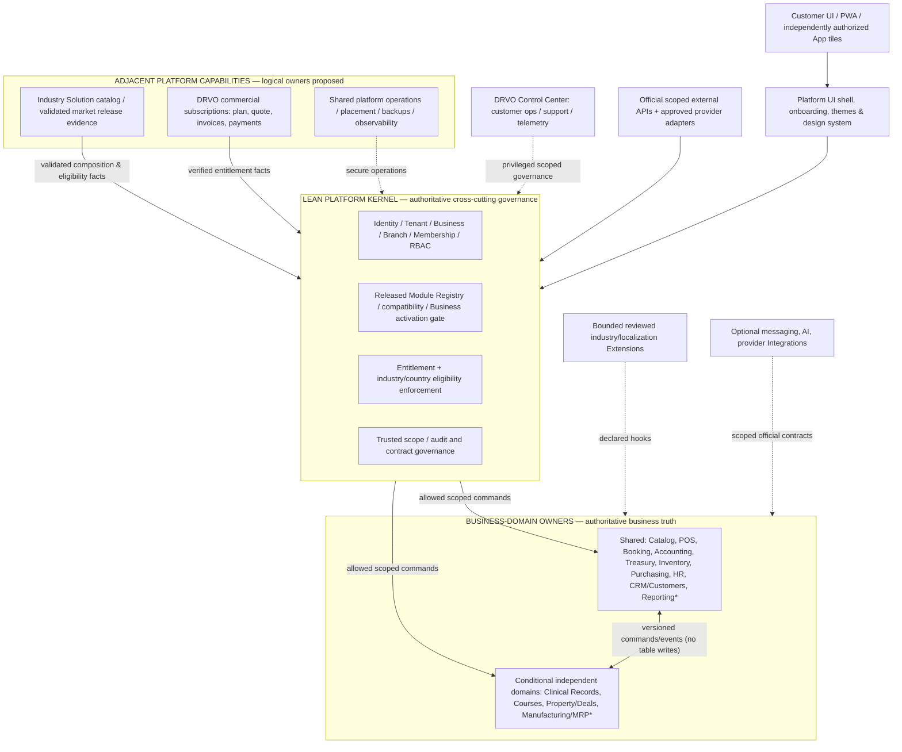
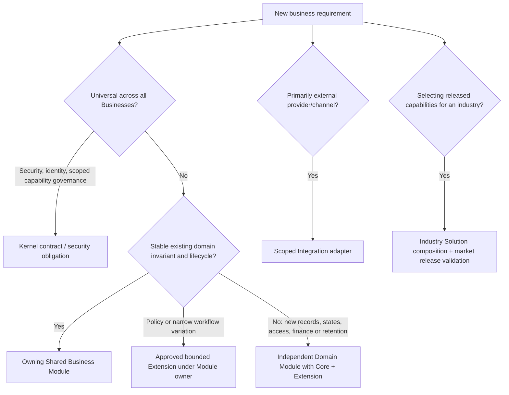

# DRVO ERP — Universal ERP Master Architecture Map V1

**Date:** 2026-10-31  
**Status:** **UNIFIED PHASE-0 REFERENCE / OWNER & BOUNDARY MAP — NOT A FULLY APPROVED TECHNICAL DESIGN OR IMPLEMENTATION SIGN-OFF.**  
**Authority:** [Founder Charter](../00-start-here/PROJECT-NORTH-STAR-ARCHITECTURE-CHARTER.md) → [Constitution V1](../00-start-here/DRVO-CORE-ARCHITECTURE-CONSTITUTION.md) → [Accepted ADR Register](../05-decisions/DECISIONS.md) → this navigation/ownership map → targeted technical working drafts. [ADR-037](../05-decisions/ADR-037-LEAN-PLATFORM-KERNEL-BOUNDARY.md) approves the **Lean Kernel principle**, not the physical packaging of every adjacent responsibility.

> **DRVO builds the repeatable factory for new industries. Shared universal platform authority stays in a lean Kernel; business lifecycles belong to reusable or independent owned Modules; industry/country fit is composed and verified before support is claimed.**

## 1. Full platform picture — one product, separable owners

**Caveats:** Examples in Shared/Domain lists are a **candidate capability catalog**, not proof every App is a released V1 Module, priced tile or approved database table. Reporting ownership may be composition of domain-owned projections and a shared reporting capability — to design later. Diagram arrows are logical trust/ownership flows, **not** approved network, runtime, schema or financial transaction topology. V1 is a Modular Monolith with tenant-aware shared SQL Server initial direction; future pools/dedicated placement require evidence.

## 2. Where every responsibility belongs — founder-facing lookup

| A new requirement is about… | First accountable owner / placement | Hard boundary |
|---|---|---|
| User account, login, session, Tenant/Business/Branch scope, role permission | **Kernel Identity & Authorization** ([Kernel 01](PLATFORM-KERNEL-IDENTITY-TENANCY-AUTHORIZATION-BOUNDARY-V1.md)) | HR employee profile/payroll belongs to HR; client UI doesn't grant access |
| DRVO-reviewed Module version, permitted dependencies, extensions, active Business capability | **Kernel Registry & Lifecycle governance** ([Kernel 02](PLATFORM-KERNEL-MODULE-REGISTRY-AND-LIFECYCLE-BOUNDARY-V1.md)) | Module data/workflow never moved into Registry; ADR-032 technical activation remains proposed |
| Whether a Business can use a capability under plan/grant/expiry | **Kernel Entitlement gate** ([Kernel 03](PLATFORM-KERNEL-ENTITLEMENTS-AND-SUBSCRIPTION-BOUNDARY-V1.md)) | DRVO subscription invoicing/settlement is a distinct commercial owner |
| Shared trusted actor/scope, security audit framework, contract rules | **Kernel Audit/Contracts** ([Kernel 04](PLATFORM-KERNEL-AUDIT-AND-CONTRACTS-BOUNDARY-V1.md)) | Every Module owns its authoritative domain records, legal history and events |
| Quoting/charging an **ERP customer for DRVO plans/apps**, refunds/renewals | **DRVO commercial billing capability (adjacent, proposed packaging)** | Not the customer's own POS receipts/Accounting invoices |
| Customer sale, invoice, refund, cart, service checkout | **POS/Sales owning Business Module** | Kernel only checks scope/capability; Accounting owns GL semantics |
| Chart of accounts, journals, periods, balances | **Accounting Business Module** | Kernel does not post journals; first POS→GL posting decision ADR-031 open |
| Cash, tender, bank movements, Business treasury | **Treasury and relevant owned payment/settlement domain** | Don't confuse external gateway evidence with verified tender |
| Appointments and resource availability | **Booking Module** | Clinical encounters aren't generic Booking fields |
| Employees, compensation, commission, payroll | **HR Module** | Kernel login is not an HR payroll identity ledger |
| Stocks, purchase orders, suppliers, production | **Inventory/Purchasing; new Manufacturing/MRP Domain if lifecycle justifies** | Ownership selected by invariant, not by an industry's label |
| Sensitive medical visits/prescriptions/consent | **Independent Clinical Domain Module(s), if and when validated** | No generic Customer/Booking data leak or default clinic enablement |
| Sector presets, starter selection, default roles, launch checklist | **Industry Solution productization/catalog (adjacent, proposed placement)** | Composition references released compatible modules, cannot weaken Core safeguards |
| Regional tax, privacy, residency/locale implementation | **Relevant domain-owned localization/extension plus compliance review; Kernel eligibility gate** | Egypt readiness does not imply Saudi/UAE or Clinic readiness (ADR-036) |
| WhatsApp, AI, payment providers, external services | **Approved optional Integration/Adapter** | External API with scoped credentials; no direct production SQL; no unsafe third-party code |
| App navigation, per-Business theme, accessible UI and characters | **Shared product UI shell/design system** | Visibility isn't server permission; each authorized user-facing Module keeps its App tile |
| Backups, tenant placement, monitoring, reliability and scalable hosting | **Infrastructure / Operations** | Modules & Kernel declare scope/evidence obligations; operational capacity proven separately |
| Holding/group relation and shared enterprise reporting | **Optional Enterprise organization capability / explicitly authorized reporting contracts (placement proposed)** | A group is not automatic common books, access or legal identity |

## 3. Decision router — new request: where does it go?

The router is **classification guidance**, not an executable algorithm. One feature may need several coordinated owners (e.g. salon service checkout touches POS/HR/Inventory/Accounting). Keep a **single authoritative owner per record/rule** and use scoped contracts for other effects.

## 4. A standard Business starts here — never a custom ERP fork

1. **Identify legal/financial Business boundaries** under a Tenant; choose Branches and optional group references without giving automatic cross-Business permissions. Primary industry is a recommendation, never an exclusive immutable Business type (ADR-033/034).
2. **Assess intended workflows & country:** determine existing released supported combinations and any fit-gap; record unsupported requirements honestly (ADR-036).
3. **Pick a customizable Industry Starter:** show recommended released Modules/Extensions; use smallest **valid** set for that Business (ADR-020/021).
4. **Resolve Required dependencies, versions, permissions and costs:** full Required bundle plus applicable charges and **one explicit approval** (ADR-007/016); no hidden paid activation.
5. **Verify valid entitlement, eligibility, activation and user/Branch authorization** independently; show authorized independent App tiles (ADR-015). The technical states/approval roles are not final.
6. **Operate inside owned Modules** — any sale, booking, ledger, clinical record, payroll or stock movement is recorded by its proper authority; Kernel adds trusted isolation/audit; no cross-module table writing.
7. **Add compatible Modules/Branches later** by the same release/activation rules while preserving historical records. Upgrades and Enterprise capacity require separate, explicit design and validation.

## 5. A completely new industry enters through a repeatable product factory

**Intake → discover sector workflows / legal privacy / volumes / actors → fit-gap with existing Modules → classify Core reuse / bounded Extension / independently owned Domain Module / provider Integration → validate country + security + accounting + capacity risk → build/test only after engineering authorization → publish a compatible released Module/Extension/Industry Solution composition → document limitations and allowed markets → use recommended Starter and one valid activation path → onboard second unrelated Business via released configuration rather than client-specific branch.**

Follow [New Industry Onboarding Playbook](../04-execution/NEW-INDUSTRY-ONBOARDING-PLAYBOOK.md) and [Fitness Gates](UNIVERSAL-ERP-SCALE-AND-INDUSTRY-FITNESS-GATES.md). A repeatable factory **does not** mean every industry or country is already supported or that an industry package alone proves operational Enterprise scalability.

## 6. Architectural obligations (no exception by industry, size or payment plan)

- Trusted Tenant/Business/Branch isolation (including workers, files, reports, caches, exports and integrations); a platform support role is not unrestricted HR/medical access.
- Authoritative domain record ownership; versioned commands/events with scoped authorization, careful sensitive payloads, idempotent financial effects and explicit reconciliation when needed.
- Verified permissions + released compatible Module + validated sector-country support + actual Business entitlement/activation; do not infer true access from the launcher.
- Financial truth: no fabricated paid/posting status, silent journal mutation, lost historic liabilities or deleted audit on expiry/upgrade/offline recovery.
- Commercial right, operational ability and Business transaction truth are separate.
- Future enterprise capacity, recovery, tenant placement and cross-border compliance are proven with actual tests/evidence before advertised.
- Same platform codebase; approved third-party in-platform Extensions only; external Integrations connect via official scoped APIs, never direct production SQL.

## 7. Current maturity and where to read

| Architectural area | Present status | Primary source |
|---|---|---|
| Three-pillar founder mission / seven laws | **ACCEPTED — stable Phase-0 principles** | [Charter](../00-start-here/PROJECT-NORTH-STAR-ARCHITECTURE-CHARTER.md) / [Constitution](../00-start-here/DRVO-CORE-ARCHITECTURE-CONSTITUTION.md) |
| Mixed-industry Business, optional Enterprise, governed Extensions, verified country support | **ACCEPTED founder decisions** | ADR-033..036 in [register](../05-decisions/DECISIONS.md) |
| Lean Kernel vs independent Domain owner principle | **ACCEPTED founder decision** | [ADR-037](../05-decisions/ADR-037-LEAN-PLATFORM-KERNEL-BOUNDARY.md) |
| Kernel 01 — Identity/Scope | **Working boundary map; technical isolation open** | [Kernel 01](PLATFORM-KERNEL-IDENTITY-TENANCY-AUTHORIZATION-BOUNDARY-V1.md), ADR-030 proposed |
| Kernel 02 — Release/Registry/Lifecycle | **Working map; activation design open** | [Kernel 02](PLATFORM-KERNEL-MODULE-REGISTRY-AND-LIFECYCLE-BOUNDARY-V1.md), ADR-032 proposed |
| Kernel 03 — Entitlements/Billing separation | **Working map; commercial policies open** | [Kernel 03](PLATFORM-KERNEL-ENTITLEMENTS-AND-SUBSCRIPTION-BOUNDARY-V1.md) |
| Kernel 04 — Auditing/Contracts | **Working map; technical flows and posting open** | [Kernel 04](PLATFORM-KERNEL-AUDIT-AND-CONTRACTS-BOUNDARY-V1.md), ADR-031 proposed |
| Sector-owned Modules, adjacent product catalogs/DRVO billing/ops | **Principles accepted; exact owners/packages, first release scope open** | [Industry Architecture](INDUSTRY-SOLUTIONS-ARCHITECTURE.md), [Core/Extension boundary matrix](CORE-EXTENSION-DOMAIN-BOUNDARY-MATRIX.md) |
| Actual SQL/API/financial/security/operational readiness | **NOT ACCEPTED / NOT IMPLEMENTED / NOT TESTED** | [Foundation Closure & Readiness Gates](../04-execution/FOUNDATION-CLOSURE-AND-NEW-INDUSTRY-READINESS-GATES.md) |

## 8. How an engineer or AI agent should work without architectural drift

1. Read Charter → Constitution → Accepted ADRs → **this Master Map**.
2. Name **the domain owner and data source of truth**, the correct classification (Kernel / Module / Extension / new Domain / Integration / adjacent platform / infrastructure), and the target Tenant/Business/Branch scope.
3. Explain the exact crossing contract and security/finance/compatibility obligations; do not create direct data ownership exceptions.
4. Check whether the rule is **ACCEPTED** or a **PROPOSED** implementation detail. If a new platform-level policy is genuinely required, create a proposed ADR and seek explicit approval before treating it as law.
5. Consult approved Industry/Country eligibility, mandatory Required dependencies and fully approved cost previews; do not assume future market/product readiness.
6. **Do not start coding on this conceptual map alone.** Clear the targeted pre-code gates and get separate engineering authorization; run tests and produce evidence before claiming correctness.

**Phase-0 scope:** One product, known logical ownership and repeatable industry intake. No newly selected database schema, microservice topology, SaaS pricing, tax engine, POS first journal commit or unsupported country certification. No code/SQL/Production action.
