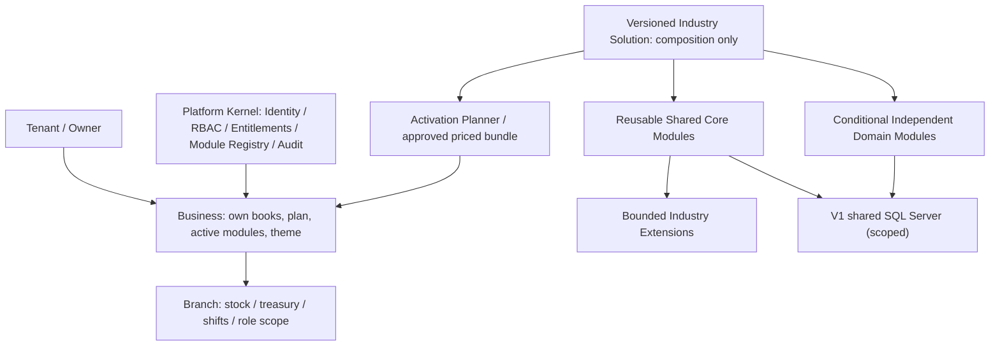

# DRVO ERP — Foundation Architecture Review 01: Modularity, Isolation, Finance and Scale

**Review date:** 2026-10-30
**Status:** DOCUMENTATION-ONLY ARCHITECTURE ASSESSMENT. Not a code audit, penetration test, load test, database benchmark, implementation sign-off or production certification.
**Founder's top-level mandate:** [Three-Pillar Architecture Charter](../00-start-here/PROJECT-NORTH-STAR-ARCHITECTURE-CHARTER.md) / [ADR-029](../05-decisions/ADR-029-THREE-PILLAR-UNIVERSAL-ERP-ARCHITECTURE.md).
**Reviewed baseline:** [Module Registry draft](MODULE-REGISTRY-DEPENDENCIES-CONTRACTS.md), [Module Lifecycle draft](MODULE-LIFECYCLE-AND-COMMUNICATION-CONTRACTS.md), [Tenancy Blueprint](TENANCY-ARCHITECTURE.md), [Core/Extension Boundary Matrix](CORE-EXTENSION-DOMAIN-BOUNDARY-MATRIX.md), [Industry Solutions](INDUSTRY-SOLUTIONS-ARCHITECTURE.md), [Industry Starter draft](INDUSTRY-STARTER-AND-ACTIVATION-DESIGN.md), [SaaS Scale Strategy](SAAS-SCALE-CATALOG-AND-CONTROL-CENTER.md), [Incremental Growth](INCREMENTAL-BUSINESS-MODULE-GROWTH.md).
**Finding codes:** `P0` = MUST have signed contract before dependent implementation; `P1` = before launch/relevant industry activation; `P2` = should design as seam, can defer full operational build. These are review priorities, NOT reports of production incidents.

## 1. Executive architecture assessment

**Strategic design foundation is promising, but NOT yet implementation-ready across its highest-risk boundaries.** Already accepted: one Modular Monolith, independent user-facing Apps (ADR-015), required/optional dependencies and one priced approval (ADRs 007/016), Shared Core/Extensions/conditional Domain Modules (ADRs 006/017/019), versioned Industry Solutions, valid minimum Business starter + additive growth (ADRs 020/021), Salon first/Clinic next, shared tenant-aware SQL Server V1, long-term measured SaaS scaling. The baseline appropriately avoids per-customer ERP forks and claims no measured enterprise capacity.

Unresolved contract details are material because they determine finance correctness, isolation, onboarding and later enterprise migration. Do **not** turn high-level diagrams or code-generator scaffolding into an assertion of safety.

## 2. Findings register

| ID | Priority | Area | Existing evidence | Gap / likely failure if left ambiguous | Required evidence/gate |
|---|---|---|---|---|---|
| FND-01 | **P0** | Tenant / Business / Branch isolation | Tenancy blueprint defines hierarchy, scoped authorization and shared SQL | Concrete resource scope keys, composite FK/write guards, query scope, authorization matrix and worker/cache/search/export isolation are not fixed | Canonical scope contract; adversarial negative matrix; cross-Business and cross-Tenant authorization/SQL tests |
| FND-02 | **P0** | Financial consistency boundary | Registry/lifecycle drafts explicitly leave POS first GL journal **synchronous vs outbox asynchronous** open | Sale could appear “fully posted/reconciled” while GL or inventory/HR effects are pending; duplicate, crash and missing event paths | Decide original sale+GL atomic boundary vs durable pending lifecycle; exact source-of-truth statuses, idempotent correction/reconciliation tests |
| FND-03 | **P0** | Module activation transaction/entitlement | ADR-016/021 approve dependency closure, full price and one approval; state machine draft | Concurrent enable/disable, quote changes, entitlement approval and failure rollback risk partial activation/charges or invalid dependency states | State transition authority, request version/lock, quote hash, idempotency, audit and rollback rules, race tests |
| FND-04 | **P0** | Cross-module ownership / contracts | Typed commands + outbox/events and domain owner declared | Exact data ownership, transaction boundaries, event envelope privacy/versioning, permitted read projections and delivery ordering not signed off | Per-event owner/consumer schema, invariant, version contract, idempotency key and health/DLQ policy |
| FND-05 | **P0** | Release/extension compatibility | ADR-006/019, Module Registry semver/dependencies, multiple compatible extensions | Extension conflicts/preference, side-by-side version support, upgrade impact on historical Business configurations and privacy hooks undefined | Manifest compatibility policy, conflicting hook deterministic result, upgrade/rollback data plan |
| FND-06 | **P1** | Future Tenant placement / cross-pool scale | V1 one SQL Server, future shared pools/stamps and isolated enterprise deployment suggested | Data ownership/location key, migration/export, distributed support tools, backup/restore, event routing and data residency details pending | Tenant placement design seam; migration cutover/reconcile/rollback proof plan |
| FND-07 | **P1** | Enterprise capacity evidence | SaaS Scale doc explicitly differentiates industries/Tenants/transactions | No accepted numbers for concurrent users, invoices, latency p95/p99, burst traffic, data size, backups or RPO/RTO | Workload matrix by micro/SME/Enterprise, signed SLO hypotheses and reproducible load/restore tests once coding authorized |
| FND-08 | **P1** | Industry compliance / sensitive domains | Clinic records independent of Booking/Customers; finance/tax gates noted | No verified Egyptian/Gulf industry privacy/tax/medical/enterprise compliance packs; weak boundaries would leak sensitive data | Protected domain + event redaction/consent/retention and local legal sign-off before that industry release |
| FND-09 | **P1** | Business activation vs user visible App / finance | ADR-015 independent tiles; internal platform kernel / required dependencies | App visibility/entitlement might be confused with mandatory finance controls; suspended app historical access undefined | Clear ACTIVE/ENTITLED/AUTHORIZED distinction and read-only archive policy; direct API denial tests |
| FND-10 | **P1** | Multi-Business hierarchy and identity | Tenancy blueprint has one Tenant owning several Businesses and Branches; Business-owned ledgers | Cross-Business employee/account reuse, Business transfer between Tenants, consolidated read-only reports and multi-country sites unresolved | Specific sharing/transfer contracts or explicit non-support for V1 |
| FND-11 | **P2** | Pricing/modular growth | Hybrid commercial proposal and customizable starter documented | Number of modules is neither full enterprise value metric nor resource cost; site/seats/usage may cost | Transparent plan limits and entitlement metrics, no backdoor Required charges |
| FND-12 | **P2** | UX/art/custom theme | ADR-022–028 direction accepted | Unfinalized layouts/fonts/art and theme schema; important for UX but should not stall ownership/isolation architecture | Shared UI/theme contracts and accessibility testing before actual UI delivery |

**Status of findings:** these are **documentation gaps / pending architectural choices**, not observed production defects. Existing documents often recognize these unresolved issues; this review centralizes them into a prioritized gate rather than incorrectly labeling everything new.

## 3. Current architecture composition / contracts — what is already settled

**Industry scaling:** reusable Module Core is preferred only for true shared business invariants; independent Clinical/Manufacturing models are not forced into generic Booking; new industries require fit-gap/productization. **Company-size scaling:** a business adds compatible functional modules while capacity/ops is a separately measured axis; one extremely busy Business can be heavier than thousands of inactive Businesses.

## 4. Three customer walkthroughs / design review outcomes (hypothetical; no tested proof)

### Scenario S1 — Single-chair salon, 1 Branch, minimal valid operational bundle
**Goal:** a tiny customer begins transacting without a mandatory full ERP rollout.
- Create Tenant/Business/Branch; choose Salon recommended editable starter. Select only modules required for offered POS/Booking workflow; resolve transitive dependencies and finance controls. One transparent priced activation approval (ADRs 016/021).
- Staff sees only ACTIVE + entitled + authorized Apps; records are scoped to Business/Branch. Invoice created from POS must have truthful financial/journal/stock/pending states. WhatsApp absence must not stop the sale.
- Upgrade to optional Booking/Inventory/HR later without changing prior invoices or forcing technical dependencies as surprise paid add-ons.
**Assessment:** **DESIGN PASS IN PRINCIPLE** for incremental composition (ADRs 017/020/021); **BLOCKED for implementation until FND-01/02/03/04**. Exact minimum valid Salon subset not approved.

### Scenario S2 — Multi-branch salon chain (same Tenant, 1–N Businesses, several Branches)
**Goal:** consistent service prices/staff and clean branch stock, shifts, cash and permissions with consolidated owner oversight.
- Business-shared Customers/primary catalog and Branch-scoped stock/treasury/roles; cross-branch inventory/cash transfers audited and period/financial postings consistent.
- Owner switches Business/Branch; caches, rows, reports and notifications must not retain unauthorized prior context. Staff assigned one branch must not read another branch's ledger or cash.
- Multiple terminals replay duplicate offline sales and refunds; one authoritative journal/effect each; price and commission snapshots remain stable.
**Assessment:** **POTENTIALLY FITS existing model**, but **FND-01, FND-02, FND-04 and branch-scope identity/aggregation remain unverified**. No concurrency/latency evidence.

### Scenario S3 — Very large timber manufacturer / importer
**Goal:** reuse accounting/purchasing/sales/inventory, add MRP/production/WIP/landed cost and region/privacy controls without a separate DRVO fork.
- Discovery: mass units/grades, BOM, production orders, warehouses, work centers, yields/scrap, import cost and enterprise roles.
- Classify distinct Production/MRP and landed cost aggregates as independent Domain Modules, scoped timber/units extensions as bounded policy only when valid; compose a versioned Industry Solution.
- Data volume, concurrent operators, batch imports, production costing, outbox lag, uptime, placement and backup scopes require enterprise-specific design and tests; UI Module count is irrelevant to throughput.
**Assessment:** **INDUSTRY EXTENSION PATH IS STRUCTURALLY APPROPRIATE**, but actual domain interfaces and enterprise deployment **BLOCKED pending FND-05/06/07/08**. Manufacturing is NOT part of Salon V1 and no real enterprise-ready claim is justified.

## 5. Top architecture risks — proposed handling (not accepted new design decisions)

1. **Scoped identity propagation** — define Trusted Scope Context from auth/session or trusted worker execution; client supplies selection but cannot grant scope; enforce composite tenant+business+branch referential checks and server-side resource lookups; cache/search/report/outbox uniquely scope keys. Whether DB RLS complements repository guards remains open.
2. **Source-of-truth finite-state finance** — define sale accepted vs GL posted vs stock valued vs reconciliation independently. Compare A) single-transaction critical GL posting and B) durable pending GL outbox with hard reconciliation barrier. Neither selected without examining Windows POS/offline, latency, SQL atomicity and error recovery.
3. **Activation race protection** — plan version/hash, approval captured for exact quote/config, transition concurrency guard and per-Business idempotent activate/disable; no partial paid entitlement or orphan dependent app.
4. **Versioned module compatibility** — specify version compatibility across Core/Extensions, event schemas and Industry Solution pins, and separately test upgrading Business A while Business B retains older config.
5. **Tenant placement seam** — establish logical placement resolution and migration/export assumptions early, but do NOT provision multi-DB infrastructure in V1 without evidence.
6. **Budget + observability** — collect real workload and p95/p99/latency/SQL lock stats; choose capacity controls/surge isolation from measured risk, not “unlimited by architecture”.

## 6. Pre-code sign-off sequence and owners (proposed)

| Order | Owner type (proposed) | Deliverable / go-no-go |
|---|---|---|
| 1 | Architecture + Security/Product | Scope hierarchy and resource-access matrix, Business/Branch joins/FKs, cross-tenant worker/search/export negative contract |
| 2 | Finance Domain + Architecture | Atomicity boundary, sale/GL/stock/HR posting states and idempotent reversal/retry contract |
| 3 | Module Platform + Billing | Dependency planner and activation concurrent state machine, quotes/approvals, upgrade and disable contract |
| 4 | Domain/Module architects | Core Extension API, registry/manifest/versioning, event payload privacy and ownership matrix |
| 5 | Platform/Ops | Tenant placement, backup/restoration and workload/SLO modeling; SQL capacity profile |
| 6 | Product + Industry experts | Salon production boundary validation; design-only Clinic and Manufacturing fit-gap tests |
| 7 | Founder | Explicit decision on remaining options and separate permission to begin any code / test / VPS work |

No owner has been assigned; roles are proposed, not claims about staffed teams.

## 7. Existing contradictions / stale documentation to reconcile BEFORE coding
- [Tenancy Blueprint](TENANCY-ARCHITECTURE.md) historically says Module Dependencies “NOT APPROVED” and suggests Owner request/Super Admin approval; **later ADR-007/ADR-016 approve Required/Optional and full-bundle approval**, but **who can activate/approve paid add-ons remains open**. Preserve the historical note and append a clear supersession pointer rather than erasing founder discovery.
- [Start Here](../00-start-here/START-HERE.md) previously said Retail second; now corrected to founder-approved Clinic second. Elsewhere still search for stale roles/industry scope and status language when preparing development.
- Don't overstate data design: Tenancy says Business employees are a working assumption; RLS vs app enforcement is undecided. “Accepted direction” is not an approved physical SQL schema.

## 8. Acceptance record and status
- **Three Pillars:** design direction aligns with founder charter; **operational proof unverified**.
- **Architecture release readiness:** `NEEDS DESIGN` with six material P0/P1 boundaries as above.
- **Code authorization:** NONE. No repository app files, SQL migrations, tests or Production changes.
- **Next artifact:** [Core Architecture Contract Proposal](FOUNDATION-CORE-CONTRACTS-PROPOSAL.md); explicit founder/engineering choice for sale/GL posting and exact activation policy remains necessary.

**This review is a gap-analysis and decision backlog, not a completed production architecture audit.**
