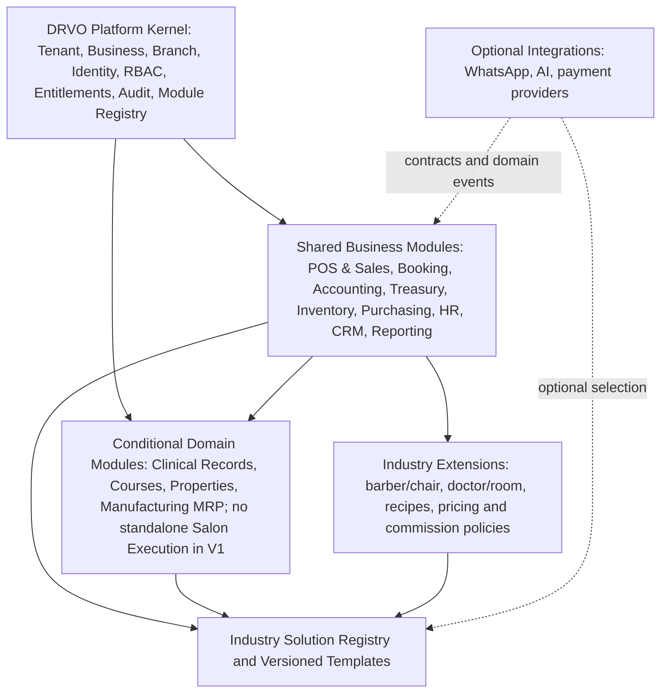

# Industry Solutions Architecture — Shared Platform, Domain Boundaries and Composition

> **MANDATORY:** [Founder Architecture Charter](../00-start-here/PROJECT-NORTH-STAR-ARCHITECTURE-CHARTER.md) and [ADR-029](../05-decisions/ADR-029-THREE-PILLAR-UNIVERSAL-ERP-ARCHITECTURE.md) require expansion into any justified industry through reusable Core, bounded Extensions and independent owned Domain Modules as needed. Industry readiness must be validated; Module count does not prove enterprise technical scale. Use [Fitness Gates](UNIVERSAL-ERP-SCALE-AND-INDUSTRY-FITNESS-GATES.md) in each fit-gap and Module review.

**Date:** 2026-10-29
**Status:** Founder-approved direction (ADR-017 and ADR-019), detailed contracts and module inventory are proposed pending design sign-off.
**Scope:** product architecture and rules, NOT code or migrations.

## 1. Product layers

Platform Kernel is a technical capability, not required to be a separately displayed App. Each *user-facing* Module remains an independent App (ADR-015). Each Module, including industry-specific ones, provides Core + explicitly advertised Extension points (ADR-006). Industry Solution is a composition, not an independently forked monolith.

## 2. Terminology and ownership boundaries

| Construct | Purpose | Example | How it changes |
|---|---|---|---|
| Platform Kernel | Universal SaaS mechanics | Auth, tenancy, entitlements, RBAC, audit | Platform release |
| Shared Module | Stable common domain invariant | Post invoice, take payment, book resource | Versioned Core with extensions |
| Extension | Bounded variation within an existing process | Salon service attribution; barber resource rules | Compatible extension release + Business activation |
| Vertical Domain Module | Fundamentally different domain model/lifecycle | Clinical records, course enrollment, property/deals, MRP | New owned Module + Core/Extension contract |
| Industry Solution | Reusable curated bundle and setup template | Salon Solution or Timber Manufacturing Solution | Versioned composition/offer |
| Integration/Add-on | Connectors/optional capabilities | WhatsApp, AI, gateways | Explicit entitlement + activation |

Industry Solution references **compatible released** module/extension versions and defaults; it is not a user-uploaded plugin that can execute arbitrary code. Required dependencies and charges are shown for one explicit approval (ADR-016), while extra Optional apps remain optional.

## 3. The boundary test: Core, Extension or New Domain Module?

1. Identify domain aggregate and invariants: what remains true across industries regardless of UI labels?
2. Compare event lifecycle and consistency rules. If the workflow shares a stable state machine, prefer shared Core.
3. If new industry changes a bounded policy/validation/resource adaptation, introduce a typed Extension hook/adapter.
4. If new industry introduces distinct identities, access sensitivity, accounting controls, state machines or data retention, use a dedicated Domain Module. Compose with Shared Modules via contracts/events.
5. If requirement is one-off external connection, use a separately versioned Integration (do not fork Core).
6. Refuse abstraction until at least two credible business examples demonstrate real commonality. Avoid speculative ten-extension inventories.

Examples:
- Appointment with barber/chair vs doctor/room: shared calendar/resource allocation may fit Booking; clinician medical records/consent do **not** fit generic Booking.
- Repeating class schedules, student attendance and enrollment: reusable scheduling may help, but Course Enrollment is a distinct domain.
- Real estate: CRM contact and lead can be generic; Property, Listing, Viewing, Agency Agreement and Deal belong in their own Domain Module; mere renaming of CRM fields is insufficient.
- Wood manufacturing: purchase order/invoice/stock movement are generic; BOM, production orders, work centers, yield and cost accounting need a Manufacturing domain with timber-specific extensions.

## 4. Cross-industry reuse matrix

| Capability | Salon | Clinic | Education center | Real estate | Timber manufacturing |
|---|---|---|---|---|---|
| Invoicing / Sales | Service + product | Consultation / procedure | Tuition and installments | Service commission | B2B supply, manufactured products |
| Booking / Scheduling | Barber/chair | Clinician/room | Course/class recurrence | Viewing appointments | Machine/work center scheduling (specialized) |
| Treasury / Accounting | Sales, payroll | Fees, payables | Tuition collection | Commissions and contracts | Landed cost, WIP, inventory valuation |
| Relationship data | Customers | Patient linkage with medical privacy | Student + guardian | Buyer + seller + owner | Customers + suppliers |
| Distinct Domain Module | Salon service execution | Clinical records | Courses/enrollment | Property/deals | MRP/production |

The matrix is **analysis guidance**, not a claim all industries are implemented or that country-specific tax/compliance is automatically covered.

## 5. Composability

Conceptual (not an approved persisted schema):
- `IndustrySolutionDefinition`: solutionKey, version, eligibleIndustries, description, requiredModuleRefs, suggestedOptionalModules, extensionCompatibility, configTemplateRef, roleTemplateRefs, onboardingSteps, migrationRefs, regionRequirements, status.
- `BusinessSolutionAssignment`: tenantId, businessId, solutionKey/version, customization overlays, selected modules/extensions, activation audit.
- `ModuleDefinition`, `BusinessModule`, ActivationRequest remain as proposed in [Module Registry/Contracts](MODULE-REGISTRY-DEPENDENCIES-CONTRACTS.md).
- One Business may tailor apps without creating a fork. Compatibility and change auditing are required for upgrade.
- A Tenant may own a salon Business plus manufacturing Business; independent accounting books and entitlements apply per Business.

## 6. Compatible runtime collaboration
Use typed sync commands/queries for required validation and same-transaction invariants, versioned domain events/outbox for independent effects, and per-consumer idempotency (see [Lifecycle and Contracts](MODULE-LIFECYCLE-AND-COMMUNICATION-CONTRACTS.md)). No direct cross-module writes despite shared DB. Solutions do not disable RBAC, tenant boundaries or financial audit.

## 7. First real delivery
- **V1:** comprehensive Salon solution, Cut Salon validation, independent user-facing Apps, SQL Server shared database; DRVO platform provisions and enables capabilities.
- **Next:** medical clinics only after sensitive data/compliance analysis. Clinical records not placed casually in Customer/Booking tables/events.
- **Potential later:** education, real estate, importing/manufacturing and other industries according to demand and readiness; no implied launch date.
- A second and third vertical are architectural tests of whether Core abstractions are real; not mandates to implement all verticals in V1.

## 8. Before implementation
Produce a Core vs Extension vs Domain Module boundary matrix *per selected capability*, domain event ownership contract, data sensitivity classification, solution manifest spec, dependency/entitlement UX, industry migration/reuse evaluation, and quantitative cross-industry/tenant isolation tests. Exact packaging and release policy remain unapproved.

**See [ADR-017](../05-decisions/ADR-017-SHARED-CORE-INDUSTRY-SOLUTIONS.md). No code permitted.**

## Founder-approved classification boundary — ADR-019 (2026-10-29)

**Option B accepted:** no mandatory one-domain-module-per-industry, and no attempt to encode every specialized domain as a Booking or Sales Extension. Create a new Domain Module only when separate aggregate ownership, state machine, access sensitivity, financial invariants or lifecycle warrant it. Salon may be entirely Shared Modules + bounded Salon Extensions until an independent Service Execution workflow justifies ownership. Clinic sensitive records should be separated from generic appointment/customer records; Manufacturing/MRP is a likely independent domain. These examples are not full technical approvals or release commitments. Follow [Core/Extension/Domain Boundary Matrix](CORE-EXTENSION-DOMAIN-BOUNDARY-MATRIX.md) and [ADR-019](../05-decisions/ADR-019-CONDITIONAL-DOMAIN-MODULE-BOUNDARY.md). All Modules must still have defined Core+Extension architecture (ADR-006).

## Business starter bundles / Salon V1 policy — founder approved ADR-020 (2026-10-29)

Every Business may start with the minimum valid modules needed for its chosen workflows and add compatible modules as the Business grows. This is distinct from narrowing the approved comprehensive Salon V1 platform deliverable. Shared Kernel and required finance/security prerequisites cannot be omitted just to advertise a minimal bundle. Salon V1 explicitly has **no standalone Service Execution Domain Module**; Booking/POS/HR/Inventory and bounded Salon Extensions own the existing service-related functions. An independent advanced execution workflow could be designed, released, then enabled per Business later. Read [ADR-020](../05-decisions/ADR-020-INCREMENTAL-BUSINESS-MODULES-AND-SALON-V1.md) and [incremental composition spec](INCREMENTAL-BUSINESS-MODULE-GROWTH.md).

## Approved Industry Starter UX — ADR-021 (2026-10-29)

Founder chose **Option B: recommended and customizable Industry Starter**. Selecting an Industry Solution presents a sensible set of recommended compatible Modules/Extensions; the Business may add or deselect optional recommendations. Global Module Registry Required dependency closure, security/financial invariants and ADR-016 full cost preview/one explicit approval remain enforceable. IndustrySolution Registry owns recommendation/template and source version, NOT the authority to override core dependencies. The selected Business configuration persists independently of future Solution updates; no unexpected forced migration or paid activation. Exact default selections/financial dependency edges and module-approval roles still need design. See [ADR-021](../05-decisions/ADR-021-CUSTOMIZABLE-RECOMMENDED-INDUSTRY-STARTER.md) and [Starter and Activation Design](INDUSTRY-STARTER-AND-ACTIVATION-DESIGN.md).

## Industry presentation capability — ADR-026 / ADR-027 (2026-10-29)

Industry Solution may recommend an original **Industry Character/Scene Pack** and an initial safe Business theme preset; a Business can override **brand palette and typography** after scoped authorization/validation without creating a code fork or changing the Business's functional modules. Art pack registry and theme engine are platform design capabilities, not new mandatory operational Domain Modules. Any custom uploaded font uses approved safe asset lifecycle; artistic scene flip is optional and reduced-motion-safe. ADR-024 Plum/Teal remains the DRVO fallback, protected semantic statuses apply regardless of theme. [Theme Blueprint](BUSINESS-THEME-ENGINE-AND-FONT-ASSETS-BLUEPRINT.md), [Character/Motion Blueprint](CHARACTER-ILLUSTRATION-MOTION-BLUEPRINT.md). No extra launch industry or implementation authorized.
