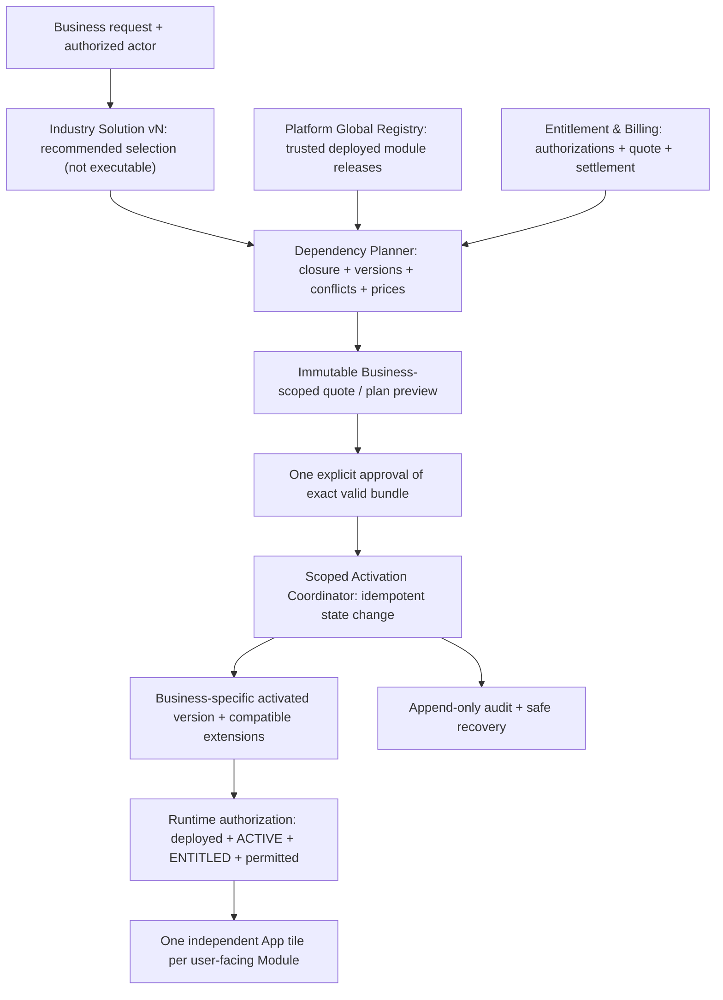

# DRVO ERP — Module Activation, Dependency, Entitlement & Versioned Solution Engine

**Date:** 2026-10-30  
**Status:** P0 IMPLEMENTATION-NEUTRAL **TECHNICAL DESIGN PROPOSAL**, not approved final DB tables/state enums/APIs. ADR-007/015/016/017/019/020/021 are **already founder-approved product policies**. No code, SQL, benchmark or production actions.
**Charter:** [Three-Pillar Architecture Charter](../00-start-here/PROJECT-NORTH-STAR-ARCHITECTURE-CHARTER.md) — one ERP for any industry and micro-to-enterprise Business via validated module composition **plus separate operational scaling**.
**Gaps:** Foundation Review FND-03 (activation concurrency), FND-05 (extension/release compatibility), FND-09 (active vs entitled vs authorized). See [ADR-032 PROPOSED](../05-decisions/ADR-032-ATOMIC-BUSINESS-MODULE-ACTIVATION-AND-VERSION-CONTRACT.md), [Adversarial Matrix](MODULE-ACTIVATION-FAILURE-TEST-MATRIX.md).

## 1. Product truth — approved and not to be silently changed

1. **ADR-006/007:** Every Business Module has reusable Core + bounded Extension points and declares Required / Optional dependencies with incompatibility detection. Multiple compatible Extensions may coexist.
2. **ADR-015:** each activated/authorized user-facing Business Module has an **independent App tile**; this does NOT imply microservices, separate DBs or a single industry mega-app.
3. **ADR-016:** show **the entire transitive Required closure** of any selected app in **one preview**, with each applicable price and a **single explicit approval**. Never silently bill/install a required dependency or paid optional.
4. **ADR-017/019:** Industry Solution is a reusable versioned composition of released Shared Business Modules, bounded Extensions, and conditionally independent Domain Modules when their true data/lifecycle require it; not a per-customer fork or arbitrary code execution.
5. **ADR-020/021:** recommend a customizable Industry Starter with Required graph enforced. A Business can start with the **minimum valid capabilities**, activate compatible modules later in the **same** Business without deleting posted history. This **does not reduce** comprehensive Salon commercial V1 platform scope. No standalone Salon Service Execution Module in V1.
6. **Financial and security invariants** are mandatory irrespective of a module tile/price. Business entitlement is scoped to valid Tenant/Business plus explicit action permission. **Module count does NOT guarantee enterprise throughput or isolation.**

## 2. Distinct layers and invariants



**Separate five concepts:**
- **Platform release:** DRVO publishes reviewed binary/manifests and any shared SQL migrations; `AVAILABLE` means compatible code can be offered, not that an individual Business purchased it.
- **Industry Solution assignment:** a Business chooses a versioned industry composition as a starting *recommendation*. It is not executable code or fixed company fork.
- **Business activation state:** chosen compatible released Modules/Extensions are configured for exactly **one Business**.
- **Commercial entitlement/payment:** purchasing/approving grants a scoped right only once valid. Manual invoicing/payment verification must not be treated as a confirmed charge automatically.
- **User action visibility:** a current authorized user sees a tile if module is deployed+supported+active, entitlement valid, **and** action/role allowed. A visible tile does not grant API rights.

**Platform foundation capabilities** (identity, tenant isolation, audit, critical financial enforcement) cannot be removed as a paid-optional trick. The exact POS↔Accounting/Treasury concrete Required edges and whether all corresponding app tiles are billable are NOT yet approved.

## 3. Minimum conceptual records / contracts (NOT SQL tables)

| Concept | Proposed fields / responsibilities | Guard |
|---|---|---|
| `GlobalModuleRelease` | moduleKey, immutable version, signature/hash, supported platform range, contracts, target markets, reviewed migration level | Only DRVO-controlled deployed code is activatable |
| `DependencyManifest` | required/optional edges, conflicts, feature-gated prerequisites, version constraints, conditional extension compatibility | Deterministic validated graph; no cycles |
| `IndustrySolutionRevision` | industry/region, recommended selection, extension/config templates, pinned compatible manifest refs | Templates cannot weaken Module/Platform invariants |
| `BusinessModuleState` | TenantId, BusinessId, moduleKey, activatedVersion, extension revisions, config status, transition version | Unique per Business/module, scoped permission, immutable history |
| `BusinessSolutionSelection` | selected Solution/revision, explicitly selected/omitted optional modules, requested reason, change provenance | Business A change never mutates Business B |
| `ActivationPlan` | selected target, exact graph closure/topology, already active, newly needed, conflicts, validated versions, operation ID, scope, revision/hash | Plan immutable once previewed; approval bound to same plan |
| `ActivationQuote` | Business/payer, approved items and **per-item cost**, applicable currency/period/tax/discount, totals, expiry, pricing revision, consent | No hidden paid prerequisites, quote rechecked before commit |
| `EntitlementRecord` | module/right, seat/branch/usage limits if adopted, authorized payment/credit/grant state, effective/end dates | Payment claim ≠ verified settlement; pricing model still open |
| `ActivationOperation` | actor+approver, idempotency key, payload hash, expected state revision, plan/quote hash, operation state, timestamps/errors | A replay never charges twice or re-seeds twice |
| `BusinessModuleAudit` | scoped before/after versions, actor, approvals, billing evidence, exceptions, replay/cancellation/rollback | Append-only, accessible by relevant authorized users |

Names and state fields are **illustrations**; final schema, storage, semantics and deployment scope require approved ADR and security/finance validation.

## 4. Planner algorithm — semantic steps only

1. Accept selected Business and requested released Module(s)/Extensions and current user; resolve verified Tenant/Business memberships and grants server-side (ADR-030 proposal, approved identity Default Deny).
2. Verify `GlobalModuleRelease` is actually deployed, approved and compatible with platform, country/region/privacy requirements; never download arbitrary customer code at activation.
3. Expand **complete transitive Required closure** for every selected capability and chosen Extensions; distinguish Module Required dependencies, feature-conditional requirements, already active prerequisites, recommended defaults and truly optional add-ons. No blanket auto-install of `optional`.
4. Validate DAG acyclicity, incompatible versions, required conditions, mutual exclusions, existing Business extensions/active modules, data migration readiness and entitlement/plan limits; any critical conflict fails **before** confirmation.
5. Identify existing active modules; preserve them, don't rebill them; compute only necessary new additions and valid bundle changes.
6. Produce **stable exact plan**: sorted deterministic dependency topology, released versions, extension IDs/versions, Business and payer scope, current Business graph revision and immutable quote/pricing reference, optional selections and cost breakdown. A graph digest/hash may help stale-plan detection but cannot replace authorization.
7. Show one clear UX preview in Business currency where policy allows, including Required explanations, current active (no duplicate charge), prices/renewals/taxes/proration if applicable, roles/permissions/data implications, conflicts and risks. Let user remove *recommended optional* apps; if removal affects a chosen Required path show which selected parent would also need removal. No deceptive consent.
8. A Business owner/other **explicitly approved approver** authorizes the exact plan and price. **Approval roles and how manual payment settlement authorizes activation remain OPEN**, not silently "Owner always".
9. Revalidate **at commit**, under Business-scoped concurrent operation guard: actor/approver, current membership and permissions, entitlement, price quote validity, release/graph revisions, exact required closure, and stale overlapping state. If anything materially changed, reject and requote with **new explicit consent**.
10. Execute idempotent initialization/config of newly activated Modules and compatible Extensions; never drop or reseed preexisting customer records. Mark target bundle fully ACTIVE only after all required obligations are satisfied; preserve audit and recover failure transparently.

**Complexity:** one Business's graph operations should serialize or use an equivalent optimistic version/CAS retry boundary while different Businesses can proceed concurrently. Do **not** hold a global Tenant/platform DB lock for every activation; prove concurrency and lock scope in future tests.

## 5. Proposed activation lifecycle and consistency model

```text
REQUESTED → PLANNED → AWAITING_APPROVAL
                           ↓ approved exact quote
             ENTITLEMENT_PENDING (if billing requires settlement/grant)
                           ↓ verified entitlement
                      ACTIVATING
                     ↙        ↘
                   ACTIVE    FAILED_REVIEW
                     ↓           ↑
                SUSPENDING    retry idempotently
                     ↓
                 SUSPENDED → reactivation after permitted entitlement
                     ↓
                  DISABLING → DISABLED (history retained)
```

- State labels are **DRAFT**, not approved schema. `AVAILABLE` belongs to platform catalog, not persisted Business state.
- Activating a *bundle* is one **logical Business operation**, but **external billing and async initializers are not atomically committed with one SQL transaction**. Never claim exactly-once remote payment, nor all-or-nothing across an external provider.
- Prefer **transactional BusinessState/entitlement commitment with replay-safe per-module config initialization** after authorized graph recheck. If initializers need multiple steps, keep `ACTIVATING` and readiness gates until all required components are confirmed; recorded compensation/retry steps must preserve existing active modules and immutable data.
- If any Required new dependency fails, **no new dependent Module may appear ACTIVE/usable**. Some completed newly initialized configs may need to stay dormant pending retry or be compensated without deleting data; **per-module rollback policies and any already-captured payment refund/credit require separate approved finance policy**.
- Explicit distinction `APPROVAL_CONFIRMED` vs `PAYMENT_VERIFIED` vs `ENTITLEMENT_GRANTED` vs `MODULE_ACTIVE`. Stale quote/canceled payment => do not mark ACTIVE or invent settled funds.
- Record every transition and action in append-only Audit; ensure idempotency keys unique in scoped Business+operation namespace and payload hash mismatch throws review conflict. Approver may differ from requester.
- A suspension/disable affects **future command authorization** but not required completion of already-committed financial events. Immutable posted invoices/journals remain readable if rights/retention permit.

## 6. Required, optional and protected dependency semantics

| Kind | Rule | Example (illustrative ONLY) |
|---|---|---|
| Always-on platform safeguard | Not purchasable toggle, cannot bypass | Tenant auth, scoped audit and required financial integrity |
| Required Module | Target cannot operate unless prerequisite valid in same Business | POS → Catalog in draft example; exact release graph **not approved** |
| Feature-specific Required | A capability requires related module, but core app may work without it | Credit sale → Customers/Credit capability; source of customer receivable must be authorized |
| Recommended | Suggested by Industry Solution, removable unless needed via another chosen Required edge | Booking for a Salon that elects to start with walk-in POS |
| Optional | Absence does not block base workflow | WhatsApp notifications, if supported/released |
| Conflict/Version | Explicit incompatible release/extension combination blocks or requires supervised transition | Two incompatible hook implementations in same scope |

**Extensions:** define hook owner, typed input/output, release compatibility, security/financial invariants, priority/conflict resolution and feature permission. For conflicting extensions, a reviewed deterministic configuration or explicit choice is required; arbitrary override order based on install time or customer-supplied code is forbidden. Do not smuggle an entire Clinical Record domain into Booking via an Extension.

## 7. Suspend, disable, downgrade, upgrade and data migration safety

- A disable request first analyzes reverse dependent graph and **active financial/stateful obligations**. If an active Module depends on target, **block by default in draft** pending an explicit future approved cascading impact plan. This conservative default is a proposed implementation policy, not yet founder-approved.
- A Business can remove optional feature access without deleting ledger, sales, HR/stock history, migration identifiers, audit, or retention-required data. Access after suspension respects rights and legal preservation and may be read-only/archive, policy still open.
- Don’t disable mandatory finance processing just because Accounting UI entitlement expires; define protected processing capabilities independently from marketing/app tiles (scope and billing TBD).
- Workflow compensation: newly staged configuration can be safely rolled back when not committed or quarantined; **never undo posted money by deleting rows**. If paid plan refunded, record proper billing ledger/refund adjustment instead of erasing activation audit.
- Upgrading a platform Module occurs as a **DRVO-controlled release** (migrations/reviews/platform-wide compatibility), then per-Business configuration/version transition. Per-Business activation cannot run ad-hoc platform schema upgrades or untrusted uploaded plugins.
- Version rules require compatibility matrix for Core API, Event Schemas and Extensions. During safe rollout, support old consumers and version upcasting or an explicit staged migration. Old Business B must not break merely because Business A upgrades.
- Extension compatibility is a **contract**, not a guarantee that any two extensions compose automatically. If old data cannot be transformed without loss, require explicit migration and authorization, not fabricated backfill or a reset.
- Deleting an Industry Solution assignment does not delete actual business domain data or change a released Module's owner of ledger/stock/customer.

## 8. Financial, tenancy and runtime boundaries
- Scope every quote, activation request, entitlement and event to server-authenticated Tenant/Business/actor. Tenant Owner requires explicit Business Membership; default deny. Direct API must reject activation even if UI accidentally shows button.
- Published Module release vs Business entitlement vs current user permissions form separate checks on **every protected command**. A cached app list is not authorization.
- Billing provider/manual approval must be separately verified and idempotent; avoid two concurrent tabs double charging or marking ACTIVE before payment/grant validity.
- A failed WhatsApp add-on activation must not roll back an existing Sale or alter shared Accounting/Inventory state.
- Reconcile outstanding activation transitions, orphan Required dependencies, stale quotes, license/billing mismatches and financial outbox after restart.
- Tenant data-placement routing, cache keys, rate limits/queues and audit must remain Business-aware in future pooled/dedicated Enterprise deployments.

## 9. National ERP / micro-to-enterprise fitness gates
- **Micro Business:** recommend a small valid starter; one short preview/approval; no unnecessary independent Service Execution or paid optional; still secure/authenticated and finance-correct.
- **Multi-branch chain:** Business-wide graph, Branch-local roles and staff App visibility; a Manager authorized for Branch 1 cannot install paid app for whole Business by accident; outstanding shifts/events remain safe.
- **Large retailer/manufacturer:** can activate released MRP/Inventory/Accounting/domain packs, handle complex version dependencies and independent rollout without bespoke repo; throughput/capacity still requires actual measurements, not 30 modules.
- **Many Tenants:** avoid global locks/mega-graph recalculation on every user request; persist read-only resolved entitlements/graph revisions appropriately with scoped invalidation. Activation operations bounded, audited and retryable. No assumed platform TPS/SLA.
- **Future Clinic:** highly sensitive Domain Module allowed only with verified privacy/consent/legal compatibility; cannot auto-enable because generic Booking is active.

## 10. Unresolved founder/engineering choices (MUST NOT be inferred)
1. Final Salon V1 actual visible App inventory, recommended starter, concrete Required dependency graph and protected GL/Treasury capabilities.
2. Approver roles, delegated Manager authorization for Business-wide purchase, trial/free/paid entitlement triggers and manual-payment verification.
3. Proration, discount, cancellation/refund/recovery and quote expiry/revalidation policy. **No pricing invented.**
4. Exact module and bundle statuses/state schema, durable staged initializer vs all-in-one transaction boundary, concurrency guard and precise shutdown/deactivation effect.
5. Cross-Version Core+Extension hook conflict policy, provider integrations, compatibility range and migration/rollback periods.
6. Sector-specific privacy/tax compliance, Module-owned event payloads, pending financial workers and future enterprise Tenant migration.
7. Final UX wireframes of one-bundle preview/disabled/status states; approved ADR-015/016/021 are **behavior** not prior rejected screen layouts.

**Acceptance:** [Adversarial Test Matrix](MODULE-ACTIVATION-FAILURE-TEST-MATRIX.md) specifies future tests; none executed. [ADR-032](../05-decisions/ADR-032-ATOMIC-BUSINESS-MODULE-ACTIVATION-AND-VERSION-CONTRACT.md) remains **PROPOSED**, no code/SQL/VPS/deployment authorization.
