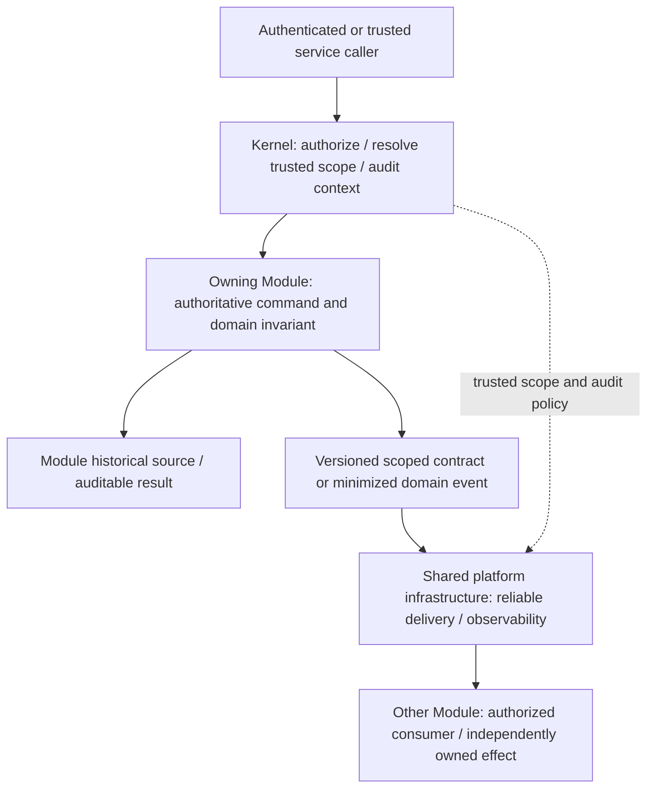

# DRVO ERP — Kernel Boundary 04: Audit, Contracts & Cross-Module Ownership (V1)

**Date:** 2026-10-31  
**Status:** **PHASE-0 WORKING DESIGN — NO NEW ADR ACCEPTED, NO TECHNICAL IMPLEMENTATION SIGN-OFF.**  
**Founder-approved foundations:** [Core Constitution V1](../00-start-here/DRVO-CORE-ARCHITECTURE-CONSTITUTION.md) (laws 2/4/5/7), [ADR-037 — Lean Kernel](../05-decisions/ADR-037-LEAN-PLATFORM-KERNEL-BOUNDARY.md), [ADR-035 — Controlled Extensions](../05-decisions/ADR-035-GOVERNED-THIRD-PARTY-EXTENSION-ECOSYSTEM.md), [ADR-019 — Domain boundaries](../05-decisions/ADR-019-CONDITIONAL-DOMAIN-MODULE-BOUNDARY.md).  
**Related technical proposals:** [Foundation Core Contracts](FOUNDATION-CORE-CONTRACTS-PROPOSAL.md), [Module Lifecycle & Communication](MODULE-LIFECYCLE-AND-COMMUNICATION-CONTRACTS.md); [ADR-030](../05-decisions/ADR-030-TENANT-ISOLATION-ENFORCEMENT.md) and [ADR-031](../05-decisions/ADR-031-FINANCIAL-CONSISTENCY-AND-POSTING-BOUNDARY.md) remain **PROPOSED**.

## 1. Exact ownership distinction

> **The Kernel sets universal trust, scope, audit and contract governance. Each owning Module produces the business truth and its own domain evidence. Shared infrastructure transports and observes only through authorized, versioned contracts.**

"Audit" here means **two complementary layers**, never that the Kernel becomes the owner of every ledger or record:

- **Platform/security audit:** actor identity, permission and high-risk access changes, Business/Branch scope, activation/release decisions, authorized support activity, provenance and tamper-evident historical expectations.
- **Domain audit/history:** POS corrections/refunds, Accounting posted journals/reversals, Treasury settlement, HR payroll adjustments, Inventory movements, Clinical consent/access events when applicable — owned and explained by the relevant Business Module and its protected rules.

## 2. Logical trust/contract path — not API/event payloads

**A shared physical database does not authorize one Module to write another Module's tables.** Event delivery design must not imply global ordering or exactly-once message transport. Cross-module mandatory financial consistency is **not resolved here**.

## 3. Rules and responsibility matrix

| Concern | Kernel / platform foundation | Module and infrastructure responsibility |
|---|---|---|
| Authoritative actor and Tenant/Business/Branch | Kernel supplies *validated* scoped identity / permission context for all privileged operations | Modules check resource ownership and enforce extra domain/sensitive protections; worker trust model ADR-030 proposed |
| Contract registry and compatibility policy | Require declared versioning, ownership, compatibility and authorized producer/consumer bounds | Owning Module defines typed commands, queries, event meaning, data minimization and lifecycle; schema details deferred |
| Platform security audit | Universal provenance and log obligations for permission changes, access and administrative lifecycle | Actual storage, retention, immutability mechanism and support break-glass yet to be designed |
| Domain financial/audit history | Kernel enforces scope/security and prohibits silent weakening/deletion | POS/Accounting/Treasury/HR/Inventory own immutable business facts/corrections and reconciliation |
| Cross-module effects | Enforce contracts, service identity, scope, protected event handling and audit expectation | Source Module owns event meaning; consumer owns own idempotent effect; outbox/inbox/queue topology proposed, not accepted |
| Integration events | No external service can gain unscoped SQL, core privilege or unrelated customer access | External provider uses official scoped versioned APIs/events; legal consent/privacy/retention in owning domains |
| Clinical/sensitive records | Kernel least privilege and market eligibility gates | Clinical Module owns medical data, consent and sensitivity controls; no general-purpose unrestricted customer event leaks |
| Error handling and monitoring | Common trust and observability expectations, no fabricated success status | Owning domain defines compensations/reconciliation; shared operations owns monitoring, backup, restore and resilience evidence |

## 4. Five non-negotiable scenarios

**A. POS posts a sale:** POS owns invoice/sale truth, Accounting owns the GL, Treasury owns its tender/cash truth. Kernel enforces actor, Business/Branch and audit context. It does **not** choose atomic commit A versus durable pending B; [ADR-031](../05-decisions/ADR-031-FINANCIAL-CONSISTENCY-AND-POSTING-BOUNDARY.md) remains PROPOSED.

**B. Worker retries the same event:** no duplicate commission, stock or journal effect can be tolerated; exactly-once *business effect* must be engineered from idempotency/reconciliation, not assumed from single message delivery. Exact inbox/outbox and transactional contract pending.

**C. Employee in Branch A requests Branch B's report:** authorization must be rejected absent explicit valid scope even via API, export, cache, reporting projection or worker; no UI-only checks. Technical isolation design under ADR-030.

**D. Optional WhatsApp provider fails:** a notification failure must not retroactively mark an already committed transaction unpaid, posted or reversed. Notifications may react through controlled, privacy-safe events; no direct DB read/write or unsupported clinical exposure.

**E. Upgrade or disable an App:** signed/compatible release and status transitions must preserve domain history, platform security audit, pending mandatory effects and capability rights. Details under ADR-032, not determined by a new Kernel event.

## 5. Never move these things into the Kernel

- The Chart of Accounts, ledger/journal entries, invoice lines, salon service attribution, payroll/commission, clinic encounter or manufacturing work order.
- Business-specific state machines disguised as universal audit status codes; generic event envelopes must not dictate business accounting.
- Direct cross-module table writes, unconstrained provider plug-ins, hidden cross-Business report aggregation or unredacted public clinical/customer event streams.
- Infrastructure assumptions like a permanently single database/region, fixed queue vendor, mandatory microservices or automatic tenant migration.
- Superuser permissions granted because somebody is the SaaS support operator or holding-company admin.

## 6. Design decisions deliberately left open

- Trusted propagation of Tenant/Business/Branch context into workers, support tools, cache, search, files and long-running jobs; SQL RLS/FK implementation (**ADR-030 proposed**).
- POS↔Accounting first mandatory posting boundary, transaction/reconciliation states, financial event effect ordering (**ADR-031 proposed**).
- Version/extension conflict resolution, stale consumer handling, upgrade/rollback, mandatory pending events on deactivation (**ADR-032 proposed**).
- Actual audit store integrity, retention, crypto/redaction, support access, healthcare country-specific safeguards and SLO tests.
- Physical coupling choices (interfaces/packages, outbox, queues, storage and deployment): implementation design requires separate review.

## 7. Next foundation step

Use [DRVO Universal ERP Master Architecture Map V1](DRVO-UNIVERSAL-ERP-ARCHITECTURE-MASTER-MAP-V1.md) to locate any feature, owner or integration in one shared picture. Use [Foundation Closure & New Industry Readiness Gates](../04-execution/FOUNDATION-CLOSURE-AND-NEW-INDUSTRY-READINESS-GATES.md) for explicit gates before claiming engineering readiness. They document *where things belong* without declaring code ready.

**Status reminder:** Phase-0 documentation only; no code, SQL, tests, server or Production actions.
