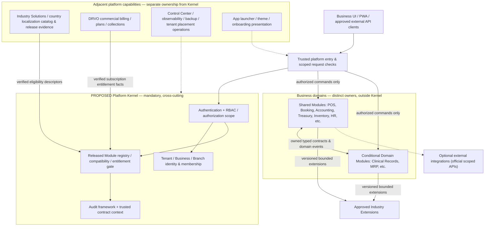

# DRVO ERP — Platform Kernel Boundary Map V1 (Founder Review Draft)

**Date:** 2026-10-31  
**Status:** **PROPOSED — Phase-0 conceptual boundary map for founder review. NOT an accepted ADR or implementation authorization.**  
**Purpose:** Separate *universal platform authority* from *Business-domain ownership* in one globally evolvable DRVO ERP platform. **The seven-law Constitution V1 and accepted ADR-002/003/006/007/015–021/029/033–036 remain authoritative.** This document proposes placements and flags unresolved implementation choices; it does not pre-design every Module.

**Read first:** [Founder Charter](../00-start-here/PROJECT-NORTH-STAR-ARCHITECTURE-CHARTER.md) → [Seven-law Constitution](../00-start-here/DRVO-CORE-ARCHITECTURE-CONSTITUTION.md) → [ADR Register](../05-decisions/DECISIONS.md) → [Constitution V1 Foundation Review](CORE-CONSTITUTION-V1-FINAL-FOUNDATION-REVIEW.md).

## 1. One-sentence boundary

> **The Kernel decides WHO / WHICH BUSINESS SCOPE / WHETHER A RELEASED CAPABILITY IS AUTHORIZED. Each Module owns WHAT ITS BUSINESS OPERATION MEANS and its authoritative domain data.** The Kernel is a small, mandatory platform control plane, not an ERP super-module, domain database, financial ledger, UX dashboard or an industry engine.

"Control plane" is a conceptual responsibility split, not an additional microservice, process or deployment.

## 2. Conceptual map (not SQL, API, service or package topology)

**Interpretation:** A single V1 Modular Monolith and tenant-aware SQL Server may host many of these logical owners. Arrows show conceptual contracts, not direct data-table writes, deployment dependencies, mandatory synchronous calls or a finalized finance transaction strategy. An approved integration is never granted SQL access by this diagram.

## 3. Boundary ownership matrix

| Capability | Recommended logical owner | Kernel responsibility | Outside-Kernel authority or boundary |
|---|---|---|---|
| Tenant, Business, Branch structural identity | **Kernel** | Canonical ownership/relationships and trusted scope, V1 Tenant→Business→Branch | Business-specific stock, shifts, bookkeeping and operations remain with their Modules |
| User account / authentication / sessions | **Kernel** | Identity, session/access validity; platform-global unique username and Tenant resolution per approved discovery | Industry-specific staff records/roles in HR do not replace authentication |
| Scoped Membership, role grants and Default-Deny authorization | **Kernel** | Authoritative allow + scope checking for APIs, jobs, files, reporting and events | Modules declare resource/action permissions and enforce their own sensitive invariants; detailed scope algorithm remains ADR-030 proposal |
| Module release/contract/compatibility registry | **Kernel** | Which versions and approved extensions are released and technically compatible | An actual POS/Accounting/Clinic implementation belongs to its Module |
| Business capability activation and entitlement gate | **Kernel** (boundary only) | Enforce active compatible authorized releases and preserved history; calculate/check required dependencies and accepted consent principle | Paid quote, charge/tax/receipt/refund processing is commercial billing; coordinator transaction details remain ADR-032 proposal |
| Industry Solution composition / recommended starter | **Adjacent platform productization catalog** (proposal) | Kernel verifies underlying modules, dependencies, activation and eligibility | Solution templates, sector recommendations and onboarding composition are not universal Kernel business logic |
| Country/industry support eligibility | **Kernel gate + adjacent release evidence/catalog** (proposed separation) | Reject/unadvertise unsupported released combinations where required | Qualified owner verifies workflows, finance/tax/regulation, security; country-specific tax and locale rules belong to relevant Modules/localizations |
| Security audit substrate | **Kernel** | Trusted actor/scope/timestamp/correlation and durable security/activation trail capability | Domain owner records domain-specific legal/audit and posted transaction history |
| Cross-module contract envelope, event context | **Shared platform infrastructure / Kernel rules** | Enforce trusted scope, versioning and auditable contract policy | Source Module owns event meaning and data; consumer owns effects and idempotency; outbox implementation deferred |
| Subscription/billing commercial process of DRVO | **Adjacent commercial billing capability** (proposal) | Kernel consumes verified entitlement/plan state, must not infer 'paid' from a pending action | DRVO plan pricing, subscription invoice/tax, payment, discounts, refunds, grace policies outside core authorization (exact commercial boundaries later) |
| Business Accounting, journal, invoicing, tax posting | **Accounting / POS / Treasury Modules** | Authorization, visibility/entitlement and audit infrastructure | Authoritative GL, sales, settlement, fiscal periods and local tax mapping are domain-owned; ADR-031 posting policy pending |
| Customers/CRM, HR, Booking, Inventory, Purchasing, Reporting | **Business Modules** | Scope/permissions/contracts | Domain records, workflows and business analytics are not Kernel data |
| Optional Enterprise org/holding reporting | **Separate optional enterprise capability** (proposal) | Kernel preserves explicit Business permissions and legal/financial boundaries | No mandatory Group entity in Kernel; no automatic cross-Business ledger merge (ADR-034) |
| Country localization implementations | **Versioned Module-local extensions/adapters and shared localization support** | Eligibility/compatibility checks | Tax calculation, currency/legal rules, translations and residency requirements cannot be decided by generic Tenant presence (ADR-036) |
| WhatsApp/AI/providers/third-party extensions | **Integration / Extension owners** | Approved runtime releases, API credentials and allowed scopes | No raw SQL/core privilege or unreviewed executable client-uploaded code (ADR-035) |
| Business app launcher, navigation, theming / art | **Shared UI shell / presentation layer** | Kernel provides effective authorization and activation state | UX/design system is cross-platform but not part of security-critical Kernel business state |
| Monitoring, backups, job workers and placement | **Operations / infrastructure** | Tenant-safe cross-cutting requirements, trusted context | Deployment, throughput, restoration, scaling implementation and capacity proof are operational concerns |

**Classification note:** Some entries above are directly required by approved laws; *exact component packaging, storage and service boundaries are proposed only*. In particular, placing Industry Solution registry, platform commercial billing and optional Enterprise organization adjacent to the Kernel is a recommendation, not a newly founder-approved architecture law.

## 4. Non-negotiable dependency direction

1. Business Modules and Extensions depend on **declared Kernel contracts** (identity, scope, approved capability state, audit), never the reverse by importing or embedding industry business rules into the Kernel.
2. A Module or Extension **never writes another Module's authoritative data tables directly**. Typed owned commands/queries and versioned scoped domain events form collaboration boundaries.
3. A shared SQL Server **does not** make every table a Kernel table. Logical owner and scope are explicit even in one physical database.
4. Every request, background job, report, file export, cache and event respects trusted Tenant/Business/Branch authorization; the presentation layer does not grant permission by hiding/revealing an App.
5. User-facing activated Modules keep their **independent App tile**; the Kernel and Industry Solution are not mandatory user-facing mega-apps (ADR-015).
6. Module software release, per-Business activation, entitlement, commercial payment and industry/country support approval are separate concepts. Do not flatten them into a single `enabled` switch.
7. Preserve history, audit and financial obligations on disable/upgrade; avoid claiming a module operation is posted/paid until its authoritative domain confirms it.

## 5. Illustrative journeys (contract intent only)

**Login and Business operation:** signed-in globally unique user → Kernel resolves trusted Tenant and explicit Business/Branch Membership → checks allow-only scope + released/entitled compatible Module + jurisdiction eligibility → passes scoped command to owner Module → Module enforces business invariant and owns the result → auditable domain effects published through approved contracts. Actual API boundaries/schema not chosen.

**Activate an App:** approved released Module → validate compatibility and required dependency closure → show complete required cost bundle for one approval (ADR-016) → separate verified entitlement/payment and authorized activation checks → Business gets the capability and authorized App tile. Exactly who approves and implementation transaction states remain open (ADR-032).

**Financial sale:** POS owns sale; Accounting owns GL; Treasury owns relevant tender/cash domain; Kernel protects scoped access and audit context **but must not post financial entries itself**. The critical first-journal commit vs durable pending accounting policy remains **ADR-031 PROPOSED** and cannot be guessed from this map.

**Country expansion:** reuse existing released Modules where their invariants fit → add reviewed country localizations / required Domain Module if needed → verify sector-country support before availability claim → no per-country ERP fork, and no automatic approval of cross-border single-Business accounting.

## 6. Four-scenario Kernel test

| Conceptual case | Why the Kernel stays small | Unproven elements |
|---|---|---|
| One-chair Egyptian Salon | Uses same Kernel identity, access and release/entitlement gates as every Business; minimal valid Module set | Exact onboarding, capacity, POS/GL contract |
| Salon chain / Tenant with multiple Businesses | Explicit Membership and scope, independent books; optional Enterprise relationship is adjacent | Cross-Business reporting and tax/legal ownership models |
| Very large manufacturer / multi-country holding | No Manufacturing lifecycle in Kernel; compatible Domain Modules and proven workload scale separately | MRP correctness, placement, capacity, jurisdiction compliance |
| Regulated Clinic | Kernel enforces scope/eligibility; separate sensitive Clinical domain owns records and consent | Clinical privacy compliance, authorization details, country certification |

**Review result:** **PASS AS A CONCEPTUAL PROPOSAL**, not tested product readiness. No new cross-industry Kernel business rule is needed in this map.

## 7. Founder review questions — platform boundaries only

**Q1 (primary, recommended):** Confirm a **Lean Platform Kernel** (universal identity/scope, access, module governance, entitlement/eligibility gates, trusted audit/contracts) rather than putting Accounting, POS, HR, Industry Solutions and DRVO commercial billing *inside* the Kernel. Adjacent platform catalogs/operations can remain platform-owned without becoming Kernel internals.

**Q2 (follow-up classification):** Keep **Industry Solution composition, country-localization release evidence, business UX shell and commercial billing** as adjacent platform capabilities; Kernel owns only the enforcement of eligibility/entitlements/permissions. Exact component package seams require later design.

**Q3 (later technical decision, no approval by this map):** Resolve ADR-030 trusted isolation implementation, ADR-031 financial posting boundary and ADR-032 activation transaction/approver design before code. Do not turn their proposals into accepted policy by publishing this map.

## 8. Approval / implementation status

- **Accepted already:** overarching Charter and Constitution V1; ADR-002/003/006/007/015/016/017/018/019/020/021/029/033/034/035/036 as individually scoped.
- **New from this document:** a *recommended* logical responsibility/ownership boundary, not an accepted ADR or final tech specification.
- **Explicitly deferred:** full data model, SQL FKs, RLS, permission evaluation internals, APIs/endpoints, events, activation coordinator, billing provider design, tax/locale policy, enterprise org schema, actual Module inventory, market certification and load/security tests.
- **No authorization:** code changes, SQL, VPS, staging, Production, or marketing unsupported sectors/countries.

After founder review, record only actual new approved boundary decisions (possibly one concise ADR if needed); then produce an implementation-level Kernel contract design only with explicit engineering authorization.
