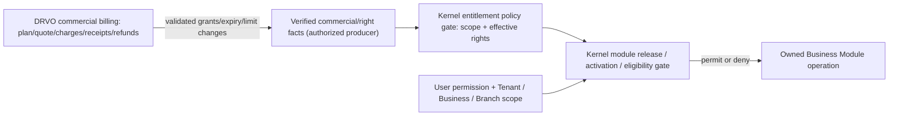

# DRVO ERP — Kernel Boundary 03: Entitlements & Subscription Boundaries (V1)

**Date:** 2026-10-31  
**Status:** **PHASE-0 CONCEPTUAL WORKING MAP — NOT AN ACCEPTED BILLING OR ACTIVATION SPECIFICATION.**  
**Authoritative approved direction:** [ADR-037 — Lean Platform Kernel](../05-decisions/ADR-037-LEAN-PLATFORM-KERNEL-BOUNDARY.md); [ADR-007](../05-decisions/ADR-007-MODULE-DEPENDENCIES.md), [ADR-015](../05-decisions/ADR-015-EACH-MODULE-INDEPENDENT-APP.md), [ADR-016](../05-decisions/ADR-016-BUNDLED-REQUIRED-DEPENDENCIES.md), [ADR-020](../05-decisions/ADR-020-INCREMENTAL-BUSINESS-MODULES-AND-SALON-V1.md), [ADR-021](../05-decisions/ADR-021-CUSTOMIZABLE-RECOMMENDED-INDUSTRY-STARTER.md), [ADR-036](../05-decisions/ADR-036-GLOBAL-READY-VERIFIED-INDUSTRY-COUNTRY-RELEASES.md).  
**Detailed design not approved:** [ADR-032 (PROPOSED)](../05-decisions/ADR-032-ATOMIC-BUSINESS-MODULE-ACTIVATION-AND-VERSION-CONTRACT.md).  
**Adjacent previous map:** [Kernel 02 — Module Registry & Lifecycle](PLATFORM-KERNEL-MODULE-REGISTRY-AND-LIFECYCLE-BOUNDARY-V1.md).

## 1. Founder-facing rule: rights versus money

> **Kernel decides whether a particular authorized Business/user may exercise a released capability right now. DRVO's commercial subscription/billing owner decides prices, invoices, collections, adjustments and financial settlement; a Business-domain Module owns the operation performed using that right.**

The Kernel must never equate a user clicking "buy", an approval, a payment screenshot or a pending provider callback with **verified financial settlement**, and may not bypass mandatory financial/security integrity because a paid App is disabled.

## 2. Ownership and trust diagram (conceptual, not physical services)

**Not selected:** whether there is a dedicated billing service, DB, event schema or synchronous entitlement call. The design requires a **trusted source** for rights and a separately enforced Kernel gate; it does not select transaction or network architecture.

## 3. Boundary ownership matrix

| Question | Responsibility / owner | Status |
|---|---|---|
| Is this a released supported Module/Extension version? | **Kernel release registry + verified compatibility** | Founder-approved platform principle |
| Is this sector-country combination eligible? | **Kernel eligibility enforcement** using qualified release/support evidence | ADR-036 accepted; record/mechanism proposed |
| Is this capability enabled for exactly this Business? | **Kernel Business-scoped activation/permission gate** | Direction accepted; exact lifecycle ADR-032 proposed |
| Does this Business have valid rights for this specific capability (including any limits)? | **Kernel entitlement enforcement** consuming trusted rights state | Principle accepted; precise commercial rights model OPEN |
| Is the user permitted to carry out this action in this Branch? | **Kernel identity/scope authorization + Module-specific action checks** | Default Deny accepted; technical ADR-030 proposed |
| What does the license cost? Who is charged? What is refundable? | **DRVO commercial billing owner (recommended adjacent capability)** | Commercial architecture/monetary policy NOT approved in this map |
| What is the balance of a customer buying hair services? | **Business POS/Treasury/Accounting** | Absolutely NOT DRVO subscription billing or Kernel |
| Which Modules are recommended for Salon/Clinic? | **Industry Solution productization/catalog** | Separate from entitlements; package location proposed |
| What happens to historical invoices and mandatory obligations after expiry? | **Domain owners with Kernel safety protections** | History preserved (accepted principle); exact read/settle behavior open |

## 4. Five independent truths — do not collapse into one boolean

1. **Released:** reviewed, deployed, version-compatible DRVO software is available in the platform.
2. **Eligible:** the Business's relevant industry/jurisdiction and required compliance/release limitations permit it.
3. **Activated:** the Business has selected/configured the permitted Module set with valid Required closure and completion evidence.
4. **Entitled:** an approved effective right applies to that Business, potentially conditioned by plan, term, grant or limits.
5. **Authorized:** the acting user has valid membership and allowed scope/action at request time.

**Right to display an App tile** is a derived UX view of these states; it is not a sixth authorization authority. **Commercial charge approval, payment intent, settlement and invoicing are separate financial facts.** Exact sequencing between these facts is intentionally not defined.

## 5. Minimum semantic entitlement contract (conceptual only)

If the team later designs a contract, it must be able to answer without relying on the caller's self-asserted permission: **who owns the grant (Tenant/Business scope), which released capability it grants, effective time/expiry, allowed scope and applicable usage/seat/Branch constraints when adopted, issuer/provenance, revocation/version and how an active operation is safely handled on change**. This is a checklist, **not an accepted schema or API**.

- Access checks are **server-side** and Tenant/Business scoped; temporary inconsistent billing state cannot mean unlimited access.
- A trial, complimentary grant or manually approved entitlement may be valid **without a settled external card transaction** when legitimately granted; do **not** assume all rights require a paid transaction. Likewise approval alone does not fabricate settlement.
- Plans, proration, grace periods, usage limits, upgrade timing, downgrade timing, branch or seat pricing, fraud/manual approvals, refunds, tax treatment and cutover rules are **commercial policy decisions not made here**.
- A Module's commercial entitlement lapse does **not** erase booked revenue, posted journals, stock history, payroll obligations, source documents, audit trails or records needed for lawful access/export/reconciliation.
- Mandatory financial correctness, isolation, audit, recovery and already-incurred obligations are not ordinary optional paid modules that can be turned off to avoid payment.
- **Revocation:** new operations can be gated based on effective authorization, but exactly which historical read, support, export, reconciliation and recovery operations survive a lapse needs explicit design; no blanket unlimited read/write promise.

## 6. Concrete scenarios

| Scenario | Required logical behavior | Deferred detail |
|---|---|---|
| One-chair Salon chooses small Starter | Only dependency-valid capabilities need to be active; no unrelated paid apps added silently | Final catalog/prices/contract |
| Owner selects POS with a missing Required App | One complete Required bundle + applicable charges in one approval (ADR-016) | Exact approver identity, quote storage and payment settlement |
| Manual payment still under verification | Do not mark money settled because someone uploaded proof; keep right status truthful | Pending access/grace policy |
| Free/trial/granted usage | Explicit valid grant can permit access without inventing paid settlement | Which promotions/plans, who may issue them |
| Subscription expires after posted POS sales | Prevent unauthorized *new* use per policy; preserve and reconcile mandatory past effects and history | Recovery/read-only access and legal retention |
| One Tenant with Businesses A and B | Activating/buying in A never grants B by default | Enterprise commercial plan sharing, if later approved |
| Upgrade/Downgrade during Business activity | Correct plan right cannot silently destroy active business history or imply irreversible unapproved charge | Transition, refund, grace and concurrency design |

## 7. Review boundary and next gates

**Directly supported by accepted founder law:** Lean Kernel gate, safe separate module/domain ownership, Business scope, Required/Optional dependencies, complete Required-cost bundle approval, independent Apps, validated market readiness and immutable historical financial obligations.

**Recommended but NOT separately signed off:** commercial DRVO billing as adjacent logical owner, entitlement fact model, revocation semantics, plan sharing policy, manager purchase rights, module status/version transition and billing↔activation consistency protocol. ADR-032 remains PROPOSED.

**Next:** [Kernel 04 — Audit & Contract Ownership](PLATFORM-KERNEL-AUDIT-AND-CONTRACTS-BOUNDARY-V1.md); then a unified navigation/owner map and *explicit pre-code decision gates*, not a claim that billing is finished.

**No code, SQL, tests, VPS, staging or Production authorization.**
