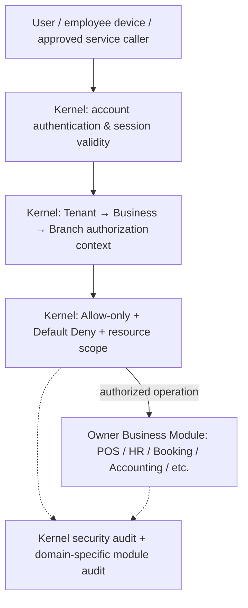

# DRVO ERP — Kernel Boundary 01: Identity, Tenancy & Authorization (V1 Working Map)

**Date:** 2026-10-31  
**Status:** **WORKING DESIGN / FOUNDER REVIEW — NOT a newly accepted ADR; NO technical schema approval.**  
**Accepted principle:** [ADR-037 — Lean Kernel](../05-decisions/ADR-037-LEAN-PLATFORM-KERNEL-BOUNDARY.md).  
**Sources of accepted requirements:** [Constitution V1](../00-start-here/DRVO-CORE-ARCHITECTURE-CONSTITUTION.md), [Tenancy Blueprint](TENANCY-ARCHITECTURE.md), [Identity & Access](IDENTITY-ACCESS.md), [ADR-003](../05-decisions/ADR-003-tenant-model.md), [ADR-033](../05-decisions/ADR-033-BUSINESS-IDENTITY-INDEPENDENT-OF-INDUSTRY.md), [ADR-034](../05-decisions/ADR-034-OPTIONAL-ENTERPRISE-ORGANIZATION-STRUCTURE.md). Detailed implementation remains subject to [ADR-030 (PROPOSED)](../05-decisions/ADR-030-TENANT-ISOLATION-ENFORCEMENT.md).

## 1. Boundary statement

> **Kernel authenticates the actor, determines an authorized Tenant/Business/Branch scope, and makes the common access decision. A Business Module decides its own business invariant and owns its domain record.**

HR employee identity/profile/payroll is a Business-domain concept, not a substitute for platform login/session identity. POS financial owner is not the identity Kernel. A platform account is not permission to inspect every Business under a Tenant.

## 2. Minimum map (logical, not runtime/SQL topology)

**Trust boundary:** Client-selected Business/Branch IDs, saved browser workspace, job payloads and extension-provided identifiers are requests to *check*, never sources of authorization. Details of how server-verified scope reaches workers/services remain a separate technical design.

## 3. What belongs to the Kernel — accepted direction vs still-open mechanics

| Concern | Principle / existing founder decision | Not yet signed-off |
|---|---|---|
| Tenant identity | Customer account and primary isolation boundary; multiple Businesses per Tenant | Physical IDs/FKs, data movement between Tenants, Tenant-placement implementation |
| Business identity and membership | Each Business in exactly one Tenant; independently controlled books/permissions; explicit Business Membership even for Owner; Business identity not an exclusive Industry | Account bootstrap/recovery after Owner creates first Business; full cross-Business permission model |
| Branch identity and scope | Branch belongs to one Business; permissions do not automatically spread across Branches | Scope evaluation for every resource type, inherited grants and cross-Branch workflows |
| Login/account identity | Founder-approved globally unique username, username/password login, Tenant resolved by platform account; accounts do not automatically cross Tenants | Token/session architecture, identity provider integrations, secure recovery details |
| RBAC baseline | One Role per user per Branch in accepted discovery; allow-only/default-deny; Manager profit/cost access only within authorized management scope | Effective role precedence, Manager-to-Manager delegation constraints, special Owner and support exceptions |
| Revocation/sensitive access | Server must reject a no-longer-authorized session on next protected request; audit high-risk actions; platform staff get no implicit unlimited record access | Revocation design for long-running jobs, emergency/break-glass policy and effective audit guarantees |
| Optional Enterprise grouping | Groups/holdings may be related in a future optional enterprise layer, but group membership alone gives no rights or merged ledgers | Organization graph schema, reporting authorization and intercompany transactions |
| Business locale policy | Existing founder choice: language/currency/timezone Business-level; one Business may combine compatible activities | Whether/how cross-border branches under one Business work; no automatic per-Branch overrides without a new decision |

**Definition of Done for this boundary in a future implementation:** an unauthorized caller cannot gain access by changing a URL, Business ID, Branch ID, cached query, export, file path or replayed worker event. Actual technical tests have **not** run.

## 4. Explicitly outside this Kernel sub-boundary

- **HR:** employment, payroll, commission, roster and employee-specific business data; Kernel may reference a scoped membership but cannot be HR's canonical payroll ledger.
- **Accounting / Treasury / POS:** own GL, cash/bank transactions, invoices and financial-day invariants; Kernel guards permission, not posting semantics or settlement status.
- **Booking, Customers, Inventory and industry Domains:** own operational entities and lifecycles; Kernel cannot write their authoritative tables.
- **UI Shell / onboarding:** offers workspace selection and role-tailored navigation, but UI filtering cannot replace server authorization.
- **Optional integrations/extensions:** use official scoped contracts and cannot self-authorize a broader Tenant/Business scope.

## 5. Short scenarios to validate the separation

1. **Single-chair Salon:** owner logs in; explicit membership in its Business; only authorized active Modules appear. No Enterprise configuration forced.
2. **One Tenant, Salon Business A + Retail Business B:** same Tenant alone does not let an employee in A read B's payroll, invoices or customers; membership/scope must allow it.
3. **Multi-branch Salon:** staff member assigned to Branch 1 with one authorized Role cannot simply alter Branch 2 in an API URL. A Manager's profit view stays within management scope.
4. **Holding / multi-country group:** organizational links do not authorize data access or merge legal books; regional eligibility and Business locale constraints need their own later verification.
5. **Future Clinic:** a general Customer or Booking permission is not permission to read a clinical record; the sensitive owning Module performs extra enforcement.

## 6. Founder boundary disposition vs technical gates

**Already accepted:** Lean Kernel, Tenant→Business→Branch baseline, separate Business books, Business ≠ Industry, optional Enterprise grouping, explicit Membership, globally unique usernames, one branch Role, Allow-only/Default Deny and scoped Manager profit. These are not being re-voted.

**Still OPEN, deliberately not decided here:** exact database scoped-key/RLS pattern; session/OTP/role precedence and Owner bootstrap; cross-Tenant or support access exceptions; multi-country Business locale; worker-scope and signed event authorization; final ADR-030 review and 40-case negative-test results.

**Next proposed Kernel review sequence:** (1) finish Identity/Trusted Scope boundary acceptance at the conceptual level, (2) Module Release Registry / compatibility / activation and entitlement ownership, (3) Audit/contracts, then (4) the adjacent Industry Solution/country/commercial billing boundaries. Do not jump from this map into schema or implementation.

**Implementation:** documentation only; no source code, SQL, VPS, staging, tests or Production changes.
