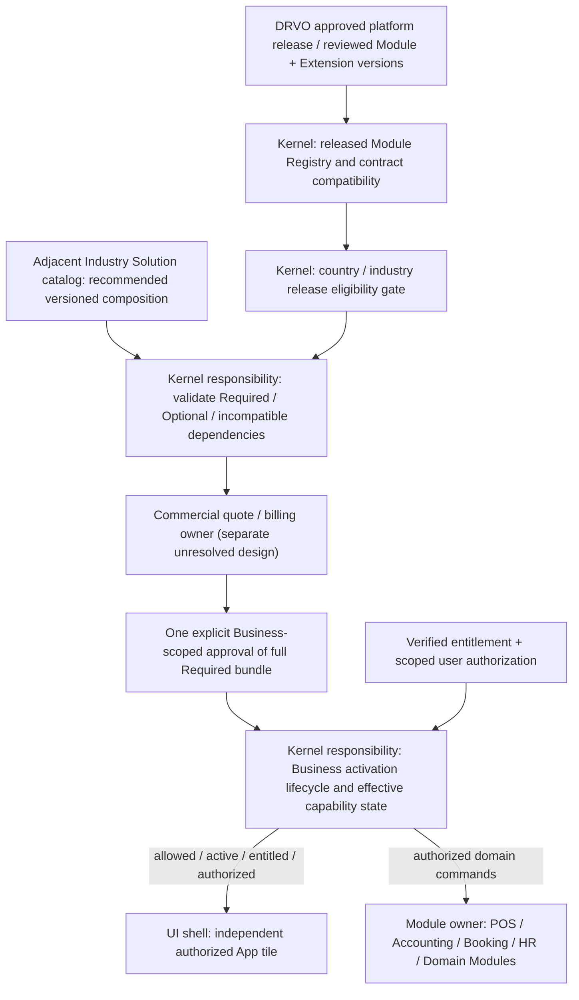

# DRVO ERP — Kernel Boundary 02: Module Registry & Lifecycle (V1 Working Map)

**Date:** 2026-10-31  
**Status:** **PHASE-0 WORKING DESIGN — NOT A NEW ACCEPTED ADR, NOT IMPLEMENTATION APPROVAL.**  
**Founder-approved Kernel rule:** [ADR-037 Lean Platform Kernel](../05-decisions/ADR-037-LEAN-PLATFORM-KERNEL-BOUNDARY.md) — universal scope, release/compatibility and capability governance belong to the Kernel; individual Business operations belong to owned Modules.  
**Existing founder-approved product decisions:** [ADR-006](../05-decisions/adr-006-every-module-extensible.md) (Core + Extensions), [ADR-007](../05-decisions/ADR-007-MODULE-DEPENDENCIES.md) (Required / Optional + conflicts), [ADR-015](../05-decisions/ADR-015-EACH-MODULE-INDEPENDENT-APP.md) (one visible App per user-facing Module), [ADR-016](../05-decisions/ADR-016-BUNDLED-REQUIRED-DEPENDENCIES.md) (one full Required bundle / charge preview / approval), [ADR-017](../05-decisions/ADR-017-SHARED-CORE-INDUSTRY-SOLUTIONS.md) and [ADR-019](../05-decisions/ADR-019-CONDITIONAL-DOMAIN-MODULE-BOUNDARY.md), [ADR-020](../05-decisions/ADR-020-INCREMENTAL-BUSINESS-MODULES-AND-SALON-V1.md) and [ADR-021](../05-decisions/ADR-021-CUSTOMIZABLE-RECOMMENDED-INDUSTRY-STARTER.md), [ADR-035](../05-decisions/ADR-035-GOVERNED-THIRD-PARTY-EXTENSION-ECOSYSTEM.md), [ADR-036](../05-decisions/ADR-036-GLOBAL-READY-VERIFIED-INDUSTRY-COUNTRY-RELEASES.md).  
**Proposal still requiring decision:** [ADR-032 — activation, quote, concurrency and lifecycle](../05-decisions/ADR-032-ATOMIC-BUSINESS-MODULE-ACTIVATION-AND-VERSION-CONTRACT.md) remains **PROPOSED**, not founder-accepted; do not infer its technical details from this map.  
**Prior boundary maps:** [Platform Kernel Map](PLATFORM-KERNEL-BOUNDARY-MAP-V1-PROPOSAL.md) and [Kernel 01: Identity / Tenancy / Authorization](PLATFORM-KERNEL-IDENTITY-TENANCY-AUTHORIZATION-BOUNDARY-V1.md).

## 1. The boundary in one sentence

> **The Kernel knows WHICH approved Module release can be offered to WHICH Business, under WHICH authorization, dependency, entitlement and country/industry eligibility constraints; the Module owns its business operations and records.**

A Module being **published**, a Business having **activated** it, a subscription being **entitled**, a user being **authorized**, and a UI App being **visible** are five different facts — not a single `enabled` flag.

## 2. Conceptual boundary map — NOT a physical architecture

**Caution:** arrows express required conceptual checks, **not** accepted temporal sequence, transaction scope, named services, database entities, payment gateways or coordinator state machine. A quote approval is NOT proof of settled payment; an App tile is NOT a security boundary. Software publishing is independent from per-Business activation.

## 3. Boundary ownership matrix

| Concern | Lean Kernel responsibility | Belongs elsewhere / still open |
|---|---|---|
| Global Module identity & published release registry | Maintain authoritative knowledge of DRVO-approved, version-compatible releases; distinguish release from Business adoption | Actual code, data aggregates, migrations, tests and operational behavior belong to Module/release owners |
| Core + Extension contracts | Require declared interfaces, ownership, compatible versions and approved Extension releases | A Module owns its real extension points and domain invariants; exact SDK/hook algorithms still future design |
| Required / Optional dependency validation | Enforce declared Required prerequisites and prevent incompatible states/conflicts for the Business | Each Module declares its own dependencies; exact initial edges and solver/CAS mechanisms not signed off |
| Industry Solution choice & Starter | Validate proposed selection against approved release/dependency/security constraints | **Proposed adjacent catalog owner:** owns templates, sector-specific recommendations and onboarding composition; its exact package placement is not approved |
| Country/industry eligibility | Enforce validated availability and forbid activation/claims outside support scope | Qualified release owners provide regulatory/finance/privacy review evidence; actual local tax/locale implementations stay outside the generic Kernel |
| Business module selection & capability activation | Apply Business-scoped governance and prevent falsely claiming inactive or incompatible functionality is active | Detailed activation coordinator, states, retries, deactivation impact and persistence remain [ADR-032 PROPOSED](../05-decisions/ADR-032-ATOMIC-BUSINESS-MODULE-ACTIVATION-AND-VERSION-CONTRACT.md) |
| Subscription rights / effective entitlement | Kernel checks verified entitlement before permitting gated operations; distinguish 'approved', 'paid', 'entitled', 'active' | DRVO commercial pricing, charge/receipt, discount, proration, refund, tax, manual settlement are separate commercial ownership decisions |
| Approval + complete cost preview | Do not activate a required bundle secretly; ensure approved scope is exactly one Business and all Required costs/prerequisites are visible | Exact approver role, confirmation timing, zero-cost bundle behavior and quote lifetime not decided |
| Permissions at command execution | Enforce trusted Tenant/Business/Branch scope, least-privilege user permission and compatibility, not just frontend visibility | Module still enforces domain-specific invariants; [ADR-030 PROPOSED](../05-decisions/ADR-030-TENANT-ISOLATION-ENFORCEMENT.md) covers physical security mechanics |
| User-facing App launcher | Expose verified effective state + allowed capabilities for frontend rendering | Shell owns tiles, information architecture, localization and animation; each active user-facing Module keeps independent App identity (ADR-015) |
| Upgrade, disable, suspend and history | Require safe compatibility/dependency/entitlement protection and immutable past obligations | Exact upgrade waves, safe-disable policy, pending jobs, technical statuses, deprecation and rollback strategy remain for future design |
| Module and security auditing | Preserve trusted actor, Business scope and provenance of release/activation decisions | Domain-specific financial/stock/clinical histories remain owned by their Modules; telemetry and physical storage are separate design questions |

**Important scope:** Kernel *governs* released Business capability, not its business data. Shared SQL Server does not make every Module table Kernel-owned. Kernel is not a new visible customer Module or mandated microservice.

## 4. Five independent lifecycles (conceptual)

1. **Platform release:** DRVO reviews/tests and publishes a compatible version of a Module/Extension for the shared product. Publishing does not grant any Tenant or Business permission.
2. **Industry Solution offering:** a versioned recommended composition references approved releases; the Business may customize compatible Optional selections while mandatory dependencies remain enforced. A Solution is not executable customer code or its own independent ERP.
3. **Business activation:** one Business selects a published capability and its Required closure; the platform validates declared compatibility, eligibility, scopes and permissions; any Required prices are shown together for **one explicit approval** (ADR-016). This does not activate the same Module in another Business under the Tenant.
4. **Commercial entitlement:** verified permission to use a paid/right-limited capability is distinct from a payment request, an approval or a partially completed activation. The precise DRVO billing engine, settlement policies and interaction with the activation coordinator remain open.
5. **User operation / App visibility:** even when a Business has an active compatible Module, a particular user can only see/use what their Tenant/Business/Branch rights permit. The frontend App tile is a derived presentation, not API authorization.

## 5. What the Kernel must NOT do

- Execute arbitrary user-submitted plugin code or accept a Business's activation as software installation/migration. In-platform Extensions need DRVO-controlled review and release (ADR-035).
- Embed Salon, Clinic, Manufacturing, POS/Accounting GL or any country's tax algorithms in a universal module registry.
- Treat a module's existence as proof of region/industry compliance, or equate a website listing with released support (ADR-036).
- Compute/own invoices, commission, stock or posted journal records as side effects of a catalog switch; those belong to domain owners.
- Assume the user who can see an App automatically has permission to execute its actions.
- Grant a module to all Businesses in a Tenant just because one Business activated it.
- Change a Business's already-posted history by disabling, suspending or upgrading an App.
- Conflate **one explicit Required bundle approval** with **settled payment**, a finished activation or a final technical workflow.

## 6. Short examples and safety checks

| Scenario | Required platform behavior | Decision boundary |
|---|---|---|
| Business selects App A that requires App B (illustrative symbols, NOT a ratified dependency) | One preview shows A + B and any charges, then one explicit approval. The Required graph must be valid | ADR-007/016 accepted; specific graphs / approver / transaction open |
| Business already uses App B | Do not silently repurchase it or overwrite its authoritative domain data when adding A | Existing rights and history preserved; quote revalidation details ADR-032 proposed |
| One Business uses Salon; another under same Tenant uses Retail | Activation, configuration, entitlement and access must stay Business-scoped | ADR-033 and Tenant/Business isolation accepted |
| Paid permission expires | Do not claim full active access without entitlement; preserve posted history and any legally mandatory obligations | Exact read-only/recovery/suspension lifecycle is OPEN |
| Incompatible Extension is proposed | Reject invalid composition; in-platform code must first have an approved release | ADR-035 approved; compatibility/conflict algorithm OPEN |
| New country is requested for an existing Module | Module code availability is insufficient; released industry/country combination needs evidence | ADR-036 accepted; formal eligibility manifests/testing still future |
| Two simultaneous activation requests | Must not silently double-charge, partially enable an unusable bundle or lose existing Business data | Needs ADR-032 founder/billing/architecture sign-off before implementation |
| Disable App with existing required dependent | Do not leave an invalid dependency state; preserve history | Specific block/cascade/recovery policy remains ADR-032 PROPOSED |

## 7. Founder review at the universal-architecture level

**Recommended classification for founder confirmation:** **Kernel Owns Governance, Modules Own Behavior, Commercial Billing Owns Monetary Truth, Industry Catalog Owns Recommendations, Shell Owns Presentation.** The first two are consistent with founder-approved ADR-037; the exact internal packaging/ownership of the latter three remains a **proposal**.

**Already accepted:** independent visible Apps, Core+Extension for Modules, Required/Optional dependencies and incompatibility enforcement, a complete Required-cost bundle with one explicit approval, Business-scoped activation, recommended customizable Starter, independently validated industry/country eligibility and controlled Extension release.

**Do not accidentally accept yet:** final V1 Module inventory or dependency edges, approver roles, payment/settlement requirements, per-Business activation state names, transaction/concurrency mechanism, default deactivation policy, extension conflict algorithm, commercial billing design or ADR-032 itself.

**Next kernel boundary:** Entitlements — define *who decides commercial rights and the minimum trusted entitlement facts the Kernel verifies*, without implementing pricing or payment flows. After that, Audit & Contract Ownership.

## 8. Documentation / execution limits

This is a **conceptual proposal** following the approved Lean Kernel boundary. It is NOT an additional founder decision, ADR-032 acceptance, implementation plan, DB schema, API contract, test run or claimed Production feature. All engineering implementation, SQL, CI, VPS and deployment remain **not authorized**.
