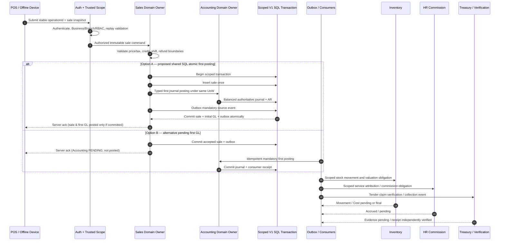

# DRVO ERP — Sale-to-Ledger: End-to-End Design Walkthrough

**Date:** 2026-10-30  
**Status:** DESIGN DRAFT FOR REVIEW — NOT AN APPROVED IMPLEMENTATION OR PRODUCT FEATURE.  
**Architecture baseline:** One Modular Monolith, one shared tenant-aware SQL Server V1, typed owner contracts, outbox/inbox, offline-first POS PWA with device IndexedDB (ADR-009). **ADR-031 Option A preferred conditionally but NOT yet selected**; B remains viable. 
**Priority:** P0 FND-02 and FND-04; applicable to **any industry** using sale/invoice/receivable/stock/commission invariants, not Salon-specific architecture.
**Read with:** [Founder Architecture Charter](../00-start-here/PROJECT-NORTH-STAR-ARCHITECTURE-CHARTER.md), [Financial Consistency Contract](FINANCIAL-CONSISTENCY-CONTRACT.md), [ADR-031 PROPOSED](../05-decisions/ADR-031-FINANCIAL-CONSISTENCY-AND-POSTING-BOUNDARY.md), [Tenant Isolation Contract](TENANT-BUSINESS-BRANCH-ISOLATION-CONTRACT.md).

## 1. Immutable priorities
1. One sale business operation yields at most **one authoritative sale and one mandatory first GL posting**, regardless of retry. Domain effects also have unique idempotent identity. **At-least-once delivery, exactly-once business effect** is a tested goal, not exactly-once message transport.
2. Sale document, GL, payment-claim verification, Treasury custody, inventory quantity/cost, commission accrual and reconciliation are **different source-of-truth dimensions**, not one “Success” flag.
3. No finance/sensitive-data access without server-derived Tenant/Business/Branch + role + active membership + operation authorization; service worker scope derived from trusted source record, not arbitrary client/event fields.
4. Original records and posted journals immutable; refunds, shortages, credit holds, incorrect tender evidence, costing adjustments and late periods use linked corrective operations.
5. Optional WhatsApp/AI/analytics downtime NEVER blocks mandatory POS+Ledger obligations. Critical accounting cannot be disabled as a way for a micro Business to avoid an app fee or override required financial controls.
6. Industry Extensions may add business-specific rules using typed hooks; they **must not** take ownership of an Accounting ledger, post directly into foreign-owned tables or duplicate source operations.
7. **Performance:** critical transaction kept bounded and measurable; do not put messages, animation, PDF rendering, analytics or remote gateway waits inside SQL commit.

## 2. Domain responsibility & order (design; no code or final event schema)



**Important corrective interpretation:** This diagram does NOT approve exact SQL transaction composition, stock posting timing or whether a particular tender is already cash physically received; these are mandatory financial model decisions still open. A SQL commit and a remote gateway settlement cannot be the same transaction. A sale cannot be called fully reconciled merely because first GL posted under A.

## 3. Generic online sale — proposed step contract

| Step | Source of truth / owner | Must hold before acknowledgement | Status after step |
|---|---|---|---|
| 0. Actor and resource | Platform Identity/RBAC; Business/Branch membership | Active permitted identity, Business and Branch valid, module entitlement and scope | `AUTHORIZED_CONTEXT` (internal) |
| 1. Customer/cart snapshot | POS + Catalog snapshot | Item/service IDs, line quantity, unit price, discounts, taxes, currency, original price rule versions, executor where applicable; correct totals | `SALE_INTENT` |
| 2. Cashier / time | POS, Shift and trusted server | Valid branch/shift, legal business timestamp vs server commit time; stable idempotency/operationId | `READY_FOR_COMMIT` |
| 3. Critical transaction (A) | POS + Accounting via typed domain command, shared scoped UoW | One immutable sale; **one balanced first GL/AR**; one source outbox; all or none | `SALE_POSTED` and `GL_POSTED` only after DB commit |
| 3b. Alternative (B) | POS + outbox then Accounting consumer | Source/outbox durable, mandatory journal owed; no false posted state | `ACCEPTED_PENDING_GL` until journal committed |
| 4. Return to device | Server authoritative result | Same operation replays return same IDs/amounts/status; unknown response shows check/retry, never a second sale | `ACKNOWLEDGED` vs `UNKNOWN_RETRY` |
| 5. Stock/HR | Inventory, HR via typed events | Each required effect idempotent and separately tracked | `STOCK_MOVED` / `COST_PENDING` / `COMMISSION_PENDING` etc. |
| 6. Treasury | Treasury / independently trusted verifier | Cash count vs bank/provider verified vs unverified evidence distinguished | `TENDER_CLAIM` or `CASH_CUSTODY` or `VERIFIED_RECEIPT` |
| 7. Reconcile | Owner-specific obligation projection | No missing mandatory source effects or unresolved required exceptions | Derived review status; not independent mutable success flag |

## 4. Worked example: simple Salon sale (illustrative, NOT account-mapping approval)

A salon sells Haircut 500 EGP. No tax rate, commission plan, stock recipe, gift card or payment account is assumed; these require Business/market configuration. Proposed UX labels demonstrate **state truth only**, not final Arabic copy or Chart of Accounts:
- Device confirms locally during outage: `Saved on this device — waiting to sync`. It is **not** “confirmed online”, “journal posted” or “payment settled”.
- Later server acknowledges: `Sale recorded; Accounting journal posted` only under A after atomic commit. Actual cash received by authorized cashier may be recorded as cash custody separately; bank deposit reconciliation still separate.
- If electronic-transfer screenshot was presented offline: `Sale recorded; transfer evidence awaiting verification`. NEVER present `PAID by bank` solely due to screenshot.
- If product consumption has no known cost: `Sale posted, inventory cost pending`; profit figure for that product cannot be fabricated.
- A commission event is pending if HR processing delayed; the employee's wage ledger remains truthful and is corrected idempotently after recovery.

Accounting ledger example **may** be revenue + AR/cash clearing and taxes, but **do not use assumed Debit/Credit account codes or settlement-to-bank accounting** until the finance mapping decision memo is approved. This document deliberately does not invent tax, VAT and employee commission percentages.

## 5. Cross-module financial obligations taxonomy (draft)

| Obligation | Proposed criticality | Owner | Why |
|---|---|---|---|
| Sale document and first mandatory balanced accounting journal | **Atomic in option A**; durable tracked pending in option B | Sales + Accounting | Main P0 correctness decision |
| Tender evidence creation and classification | Must be durably associated with source sale, settlement separate | Sales + Treasury | Avoid fake paid state |
| Cash physically received/drawer effect | Often mandatory for cash-tender sale; exact same-UoW inclusion OPEN | Treasury | Prevent invisible cash shifts, no invented bank deposit |
| Inventory *quantity* movement on stock-selling transaction | Mandatory effect by active workflow; synchronous vs outbox OPEN | Inventory | Must not “forget stock”; negative stock approved with review |
| Cost finality/negative-stock corrections | Can be pending with audited matching and later adjustment | Inventory + Accounting adjustment | ADR-012 |
| Staff attribution/commission accrual | Future outbox supported if snapshot and exact effect tracked | HR/Payroll | Not a prerequisite to print customer invoice |
| WhatsApp/SMS/push, BI, external integrations | Optional eventual side effects | Integration/Reporting | Must not gate sale or ledger |

**Key caution:** “in same transaction” is a requirement only once approved for a defined operation and configured tender. It is not a generic demand that *all* modules participate in every sale.

## 6. State model: independently verifiable source-of-truth

A UI may combine an owner-derived state vector such as:
```text
sale: POSTED
gl: POSTED
tender: EVIDENCE_PENDING
stockQuantity: RECORDED
stockCost: PENDING_UNKNOWN_COST
commission: PENDING
reconciliation: NEEDS_ACTION (with exact owner/reason)
```
This is **an illustration**, not a committed API schema/enum. It is deliberately impossible to collapse to “fully paid and complete”.

### Allowed logical transitions to design explicitly
- `LOCAL_RECORDED → SYNCING → SERVER_ACK`; in no case `LOCAL_RECORDED → GL_POSTED` without server evidence.
- `SALE_DRAFT → ACCEPTED_PENDING_GL → GL_POSTED` under B; under A only one atomic commit to `SALE+GL_POSTED`. Unknown HTTP result is not an accounting state.
- `TENDER_EVIDENCE_PENDING → VERIFIED` **or** `FAILED_COLLECTION_REVIEW` by trusted verification. Never silently overwrite evidence.
- `STOCK_MOVEMENT_RECORDED + COST_UNKNOWN → COST_PENDING → COST_CORRECTED` when defensible historical cost exists.
- Refund/correction is a **new business operation** referencing prior posted sale/journal; approval, partial quantity and total refundable amount constrained atomically.

## 7. Failures: expected behavior

| Failure window | Required future behavior |
|---|---|
| Client sends same command repeatedly | Source unique operation key + payload hash; one sale, one journal effect; same result on replay |
| Server crashes **before** SQL commit | Neither sale nor first GL survives under A; retry may create once; under B no misleading posted status |
| Server crashes **after** commit, **before** responding | Retry reads committed original; customer sees same reference, not duplicate sale |
| Accounting unavailable inside option A | Atomic sale+first journal fails; return retry/review, no fake receipt; design cashier fallback/offline separately |
| Accounting worker unavailable in option B | Durable sale remains accepted with visibly pending journal; alert, retry and period/shift handling |
| Inventory/HR downstream worker unavailable | Mandatory obligation tracked, visible queue and safe retry; no duplicate movement/commission |
| Provider screenshot disputed | Keep evidence and original sale; create collection/AR review, no bank settlement claim |
| Refund concurrent with another refund | Lock/compare original refundable balance, no negative remaining or exceeding original amount |
| Cross-Tenant/Business spoofed event | Refuse, quarantine and audit; never mutate foreign ledger |
| Device IndexedDB evicted | Device data loss incident and shift/cash reconciliation; never claim offline durability guarantee |
| Repeated events after Tenant pool migration | Preserve operation IDs, source/effect receipts and prior journal linkage, no duplicate economic effect |

## 8. Option A technical fitness budget — plan before approval (no benchmarks yet)
- Choose example workloads by (a) 1-chair micro Salon, (b) 10-branch chain, (c) high-volume retailer/manufacturer using the same common Accounting source, with peak concurrent cashiers, total sales/second, journal lines/txn, stock handlers and cross-Business load **to be defined**.
- Measure **end-to-end POS click → ack** p50/p95/p99 and SQL transactional lock/IO/concurrency latency; measure tail under outbox dispatch and heavy read reports.
- Validate exact SQL isolation level, deadlock retry handling, transaction ownership, idempotency and rollback recovery; include post-commit network loss.
- Establish acceptable latency budgets and per-tier limits with founder before claiming A passes; if A not viable at peak, evaluate well-defined B with hard pending/journal reconciliation and explicit customer-state semantics.
- Do not assume future dedicated Tenant DB requires rewriting finance: co-locate Sales/GL transactional boundary per placement or versioned strategy migration. **No distributed transaction claim** across pools or remote payment gateway.

## 9. Industry and size stress tests
- **Micro Salon:** POS+Accounting financial safety remains mandatory even if only minimal customer-visible Apps enabled; WhatsApp and HR analytics optional.
- **Salon network:** concurrent shifts/branches use correct Branch Treasury and Business books; cross-branch transfers require two valid scoped endpoints.
- **Manufacturing/importer (future design-only):** large sales still use standard source Ledger; MRP/WIP/landed cost separate Domain Modules with versioned accounting events and cost correction, no special if-manufacturing code in GL Core.
- **Clinic (future design-only):** nonclinical billing uses shared finance, medical encounter details never leak to generic accounting/notification payloads; jurisdiction-specific permission and tax/insurance rules separate owned domains.

## 10. Sign-off required
- Founder: Option A or B; acceptance that no single global `COMPLETED` means everything settled; explicit cash/evidence/user receipt UX.
- Finance lead: Chart of Accounts templates, VAT/accounting period/pending electronic tender/anonymous buyer rules and legally correct receipt/invoice wording.
- Architect: same SQL UoW ownership, stock quantity mandatory boundary, idempotency event uniqueness, refund consistency and provider integration.
- Security: [ADR-030 proposed](../05-decisions/ADR-030-TENANT-ISOLATION-ENFORCEMENT.md) trusted scoped resource checks.
- QA/performance after separate implementation authorization: [46-case Financial Failure Matrix](FINANCIAL-CONSISTENCY-FAILURE-TEST-MATRIX.md) and latency/SQL lock tests.

**Release status:** `READY FOR FOUNDER/FINANCE ARCHITECTURE REVIEW`; `FND-02/FND-04 REMAIN OPEN`; **no runnable tests and no code**.
