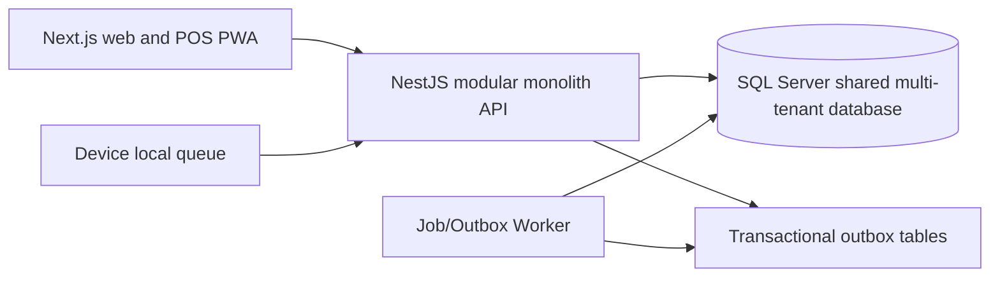

# DRVO ERP Technology Architecture — Decision and Design Baseline
Date 2026-10-29. Status: SQL Server APPROVED by founder; application stack SELECTED AS ENGINEERING RECOMMENDATION, pending founder review; critical business policies UNRESOLVED. NO CODING AUTHORIZED.

## Choice and rationale
- Database: **Microsoft SQL Server** (founder decision). Validate licensed edition/version, VPS resources and backup/restore environment before deployment; no assumption an existing unrelated database can be reused.
- Frontend: **Next.js + React + TypeScript** for Business/Branch web application and responsive POS/PWA.
- Backend: **NestJS + TypeScript** as dedicated modular-monolith API service. Domain command processing and integrations live here, not duplicated in Next.js route handlers.
- Background: independent NestJS/Node worker for offline event ingestion follow-up, outbox, retry, reports and commission accrual. Start with DB-backed outbox/job state and separately scaled worker; optional queue broker later after measured need.
- API: versioned REST + OpenAPI/typed DTO validation, authentication, per-request permission/context; real-time client events optional (SSE/WebSocket) for shifts and alerts.
- Data access: repository/data mapper layer with explicit SQL Server transactions. ORM candidate Prisma vs TypeORM vs direct driver should be benchmarked for MSSQL capabilities, locking, schema migrations, decimal precision and tenant context before selection. Avoid silently approving an ORM.
- Client offline: installable PWA/IndexedDB persistent per-device queue for POS with local encryption/credential protection subject to browser/device limitations, storage-loss incident handling, permanent client event identity and eventual sync. For stronger device guarantees, packaged local DB (e.g., Capacitor/SQLite) is an option requiring separate technical decision. Do NOT claim IndexedDB is indestructible.

## Topology

Next.js is a BFF/UI layer only; NestJS owns authoritative monetary mutations. Next.js official documentation cautions its backend-for-frontend capability is not a full backend replacement. See https://nextjs.org/docs/app/guides/backend-for-frontend and https://docs.nestjs.com/microservices/basics

## Tenancy and isolation
- Shared SQL Server database; Tenant > Business > Branch; independent Business financial books and Business-level locale. Server obtains tenant identity from authenticated account and authorized explicit Business membership. Global username unique, one branch Role, Allow-only default-deny permissions.
- Every scoped table has TenantId, BusinessId, BranchId where applicable and properly scoped compound keys/indexes; mandatory scoped FK validation and repository query filters, including all workers and export paths.
- SQL Server RLS with SESSION_CONTEXT() may provide defense-in-depth if pooled-connection context set/cleared safely, fully tested under load and service roles; NOT a replacement for backend authorization. SQL Server temporal history requires separate policy on history tables, if combined with RLS. See https://learn.microsoft.com/en-us/sql/relational-databases/security/row-level-security
- SQL transactions: enforce amount and allocation invariants, use rowversion for optimistic concurrency, locking or SERIALIZABLE transactions where required to hold credit limits; journal posted lines balance before commit; RLS and session-context security integration tests.
- Migration strategy: single versioned schema managed in CI, forward migrations and rehearsed restore. No ad hoc per-Tenant schema.
- Money: SQL DECIMAL with explicit scale and server rounding rules once confirmed; never binary floats for payment accounting.

## Module boundary
Core modules: Identity/Tenancy, Catalog, POS, Treasury, Accounting, Inventory/Purchasing, HR. Industry extensions: Salon and future Clinic. Extension joins through typed events or explicit interfaces. **Module Dependencies policy is NOT yet approved**; do not hard-code activation dependencies as founder rules.

## Offline and financial consistency
- All Business configured payment methods always selectable online/offline. Selection does not equal settlement; unverified external provider tender stays pending.
- Each POS device has independent durable queue; locally reverified former user; append-only event correction; stable (deviceId,eventId,hash) idempotency.
- Offline authenticated access TTL, device security, lost-data constraints and offline customer credit cap unapproved.
- Shift and business day may provisionally close, later reconciled/finalized; count all physically received local cash; original sale/posted dates separate; lost device incident + manual cash investigation.
- Outbox and inbox deduplication at each consumer (Accounting, Inventory, HR). Do not promise network 'exactly once' delivery; aim for exactly-once financial *effects* via unique constraints.
- Append-only posted invoices, journals, payroll corrections and source events; audits on sensitive operations and immutable provenance for finance.

## Operational model
Separate process deployments on managed VPS/container as feasible; secure TLS reverse proxy, secrets outside repo, least-privilege DB users, scheduled verified backups and tested point-in-time recovery/log backup strategy depending on SQL edition/recovery model, observability: workers' heartbeat, queue depth, sync age, delayed financial posting, tenant isolation alerts.
No target CPU/memory/cost or SLA claim until profiling.

## Gate to implementation
Product decisions B1 offline credit policy, B2 pending electronic tender outcome, B3 supported valuation/cost adjustment, B4 late closed-period posting/tax, B5 module activation dependencies, B6 commission precedence. Technical decisions T1 MSSQL edition/hosting & recovery, T2 ORM/data access/migration driver, T3 offline device storage and security, T4 tax/currency strategy. Architecture is a baseline recommendation, not implementation authorization.

## Founder final-round update (2026-10-29)

- SQL Server hosted on VPS + POS PWA with IndexedDB local queue **approved initial direction** (ADR-009).
- Required/Optional Module Dependencies with conflict prevention **approved** (ADR-007); supersedes earlier undecided note above.
- Commission Plan-configurable opener precedence **approved** (ADR-008).
- Offline credit, electronic tender confirmation, negative stock valuation, and after-month-close offline posting remain explicitly undecided. No app code to be written until gates are resolved and authorized.
