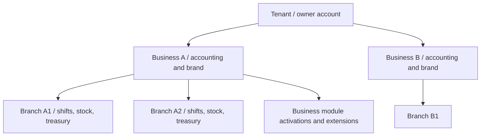

# DRVO ERP — Tenancy Architecture Blueprint

**Date:** 2026-10-28  
**Status:** Accepted domain requirements; technical schema and implementation pending  
**Evidence:** [Founder questionnaire, 40 decisions](../01-product/TENANCY-DISCOVERY-ROUND-3.md)

## Logical hierarchy

Tenant → Business → Branch. Tenant is the owner-account and isolation boundary. A Tenant can own multiple Businesses, including more than one of the same industry. A Business belongs to one Tenant and has independent branding, financial books and Business-level locale settings. Every Branch belongs to exactly one Business.

**Conceptual only — not a finalized database diagram:**

## Data ownership and sharing

| Entity / capability | Logical owner | Shared rules |
|---|---|---|
| Brand, primary prices, core settings | Business | Branch-specific price overrides |
| Customer directory and booking identity | Business | Shared across its Branches, never automatically across Businesses |
| Employees | Business (initial working assumption; to validate) | Multi-Branch schedules and access within same Business |
| Inventory and treasury / shifts | Branch | Audit-backed transfers between Branches |
| Accounting ledgers/books | Business | Consolidated read-only Tenant dashboards with explicit aggregation |
| Module activation / customized extensions | Business | Industry default set, allow multiple compatible extensions |
| Users/accounts | Tenant-scoped | Different roles at Tenant / Business / Branch scope |

Business-owned staff is an implementation proposal, not a founder-approved entity rule.

## Access model

Tenant-scoped username + password accounts. An account is not shared across distinct Tenants. Same authenticated user can hold different roles in different Branches. Default roles are editable/customizable. Manager-only access to profit/service-cost information is a product preference; exact Owner/Super Admin exceptions remain open.

Last authorized workspace is restored after login, with ability to switch among authorized Business/Branch workspaces. Any client-selected workspace must be re-authorized server-side. Audit all sensitive actions.

## Module and extension model

Business-level module enablement. Industry defaults may be overridden; one module can have multiple extensions. Disabling a module must retain historical data. Paid module activation: Owner requests, Super Admin approves. Dependency policy recommended: declared required/optional dependency contracts, DAG validation, no circular dependencies, guard deactivation if dependents exist. **Dependency design requires founder approval.**

## Scale and settings

Initial customer expectation: 1–5 Branches, 1–20 Users per Tenant. Design for larger scale without assuming these are hard caps. Business-level language/currency/timezone chosen, but all-branch regional feasibility needs review.

## Isolation requirements (implementation design to follow)

Shared tenant-aware database, tenant-scoped auth context, Business and Branch authorization; enforce tenant scoping on all reads and writes including background jobs, reports, events, search and exports. Favor tenant-scoped referential integrity and comprehensive negative security tests. Database RLS/ORM/tooling are undecided.

## Unresolved

Business transfer between Tenants, partner shares, subscription limits/expiration, full data exports, deletion/retention policy, payment entitlements, multi-country Branch settings and exact account uniqueness model. See [Open Questions](../04-execution/OPEN-QUESTIONS.md).

**No database, migrations or code have been implemented.**
