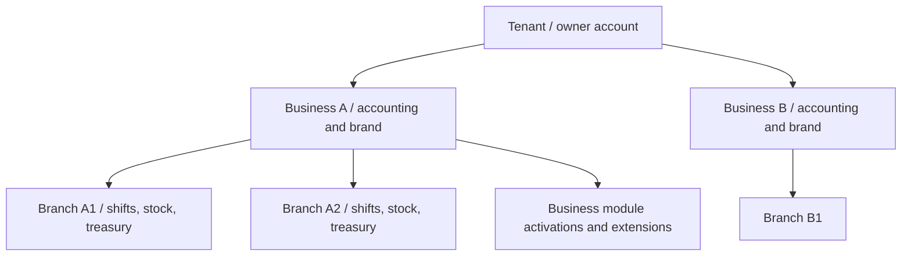

# DRVO ERP — Tenancy Architecture Blueprint

**Date:** 2026-10-28  
**Status:** Accepted domain requirements; technical schema and implementation pending  
**Evidence:** [Founder questionnaire, 40 decisions](../01-product/TENANCY-DISCOVERY-ROUND-3.md)

## Logical hierarchy

Tenant → Business → Branch. Tenant is the owner-account and isolation boundary. A Tenant can own multiple Businesses, including more than one of the same industry. A Business belongs to one Tenant and has independent branding, financial books and Business-level locale settings. Every Branch belongs to exactly one Business.

**Conceptual only — not a finalized database diagram:**

## Data ownership and sharing

| Entity / capability | Logical owner | Shared rules |
|---|---|---|
| Brand, primary prices, core settings | Business | Branch-specific price overrides |
| Customer directory and booking identity | Business | Shared across its Branches, never automatically across Businesses |
| Employees | Business (initial working assumption; to validate) | Multi-Branch schedules and access within same Business |
| Inventory and treasury / shifts | Branch | Audit-backed transfers between Branches |
| Accounting ledgers/books | Business | Consolidated read-only Tenant dashboards with explicit aggregation |
| Module activation / customized extensions | Business | Industry default set, allow multiple compatible extensions |
| Users/accounts | Tenant-scoped | Different roles at Tenant / Business / Branch scope |

Business-owned staff is an implementation proposal, not a founder-approved entity rule.

## Access model

Tenant-scoped username + password accounts. An account is not shared across distinct Tenants. Same authenticated user can hold different roles in different Branches. Default roles are editable/customizable. Manager-only access to profit/service-cost information is a product preference; exact Owner/Super Admin exceptions remain open.

Last authorized workspace is restored after login, with ability to switch among authorized Business/Branch workspaces. Any client-selected workspace must be re-authorized server-side. Audit all sensitive actions.

## Module and extension model

Business-level module enablement. Industry defaults may be overridden; one module can have multiple extensions. Disabling a module must retain historical data. Paid module activation: Owner requests, Super Admin approves. Dependency policy recommended: declared required/optional dependency contracts, DAG validation, no circular dependencies, guard deactivation if dependents exist. **Dependency design requires founder approval.**

## Scale and settings

Initial customer expectation: 1–5 Branches, 1–20 Users per Tenant. Design for larger scale without assuming these are hard caps. Business-level language/currency/timezone chosen, but all-branch regional feasibility needs review.

## Isolation requirements (implementation design to follow)

Shared tenant-aware database, tenant-scoped auth context, Business and Branch authorization; enforce tenant scoping on all reads and writes including background jobs, reports, events, search and exports. Favor tenant-scoped referential integrity and comprehensive negative security tests. Database RLS/ORM/tooling are undecided.

## Unresolved

Business transfer between Tenants, partner shares, subscription limits/expiration, full data exports, deletion/retention policy, payment entitlements, multi-country Branch settings and exact account uniqueness model. See [Open Questions](../04-execution/OPEN-QUESTIONS.md).

**No database, migrations or code have been implemented.**

## Founder follow-up decisions — 2026-10-28

- **Profit and cost visibility:** a Manager always has access to profits and service costs **within their authorized management scope**. Cross-Business and cross-Branch reach, Owner access, and fine-grained field permissions require a complete RBAC matrix; this does not grant global Tenant access.
- **Locale settings:** currency, interface language, and timezone are configured at **Business level only**. No Branch-specific overrides are part of the approved design. Multi-country Businesses must be validated against this constraint during data model design.
- **Module Dependencies:** **NOT APPROVED**. Founder requested detailed design discussion before choosing dependency enforcement and activation behavior. Do not implement a dependency DAG as an accepted product choice yet.

## Identity follow-up — 2026-10-28

Platform-wide unique username; sign in with username/password without asking for Tenant; tenant resolved from that distinct account. Accounts remain separate across Tenants. Business membership is explicit even for Tenant Owner. One Role per Branch, Manager can create Managers (authorization escalation rules pending), Owner/Manager can create employee accounts. See [Identity & Access](IDENTITY-ACCESS.md). This supersedes the prior suggestion of tenant-qualified usernames.

## Later ADR clarification and isolation audit — 2026-10-30

**Historical status reconciliation:** the 2026-10-28 note saying “Module Dependencies NOT APPROVED” reflected an earlier stage; it is **superseded by ADR-007 (Required/Optional/conflict model) and ADR-016 (Required bundle full-price preview and one explicit approval)**. However, the earlier “Owner requests / Super Admin approves” paid activation line is **NOT** final global approval/role policy; [Module Lifecycle Draft](MODULE-LIFECYCLE-AND-COMMUNICATION-CONTRACTS.md) still treats final activation approver/paid roles as OPEN. Founder-approved identity username uniqueness changes are also documented above; do not resurrect tenant-qualified username assumptions from older paragraphs.

**Architectural gap:** the logical hierarchy and negative-isolation intent are approved, but specific Tenant/Business/Branch SQL FK shape, worker scope, cache/search/export/query enforcement, support-operator privilege boundaries and RLS choice are **not yet signed off or tested**. Treat [Foundation Review FND-01/FND-10](FOUNDATION-ARCHITECTURE-REVIEW-2026-10-30.md) and [Trusted Scope Contract Proposal](FOUNDATION-CORE-CONTRACTS-PROPOSAL.md) as a **mandatory pre-code technical review**, not an implemented schema. No code/DB changes authorized.
