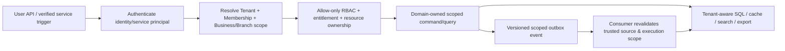

# DRVO ERP — Tenant, Business & Branch Isolation Contract (V1 Design Draft)

**Date:** 2026-10-30
**Status:** **PROPOSED TECHNICAL CONTRACT — NOT YET FOUNDER-APPROVED OR IMPLEMENTED.** Existing product decisions explicitly marked below are already accepted. No app code, SQL DDL, migration, production change, security test or benchmark performed.
**Authority:** [Founder Three-Pillar Architecture Charter](../00-start-here/PROJECT-NORTH-STAR-ARCHITECTURE-CHARTER.md) / ADR-029; Foundation audit finding FND-01, FND-10; [Identity/Access](IDENTITY-ACCESS.md), [Tenancy](TENANCY-ARCHITECTURE.md).
**Scope:** All user-facing Module APIs, background jobs, cross-module calls, events, search, export, aggregation, caches, storage, theme/font assets and future Tenant data placement. Industry-specific confidential domains may impose **stronger** boundaries.

## 1. Security goal and existing founder-approved requirements

No authenticated identity, Module, worker, support operator, background job, search index or cached UI may read or mutate a different Tenant's non-public data; within one Tenant, Business and Branch boundaries plus explicit authorization remain independently enforced. Security must survive malicious IDs, replay, stale membership, client-supplied filters and cross-module events.

**Already approved:**
- A Tenant is a customer owner-account/isolation boundary; hierarchical **Tenant → Business → Branch**. Each Business is owned by exactly one Tenant, and each Branch by exactly one Business; independent Business books/branding and Business-level language, currency, timezone (no Branch override in currently accepted domain).
- Initial V1 **one shared tenant-aware SQL Server DB** and Modular Monolith, with longer-term scalable Tenant placement as an architectural seam — not separate DBs for every Business now.
- Usernames unique **platform-wide**, login using username/password, Tenant resolved from authenticated account; accounts are separate across Tenants. The client does not supply an authoritative Tenant ID.
- **Business Membership explicit even for Tenant Owner**; users may hold a Role per Branch, different Branch access allowed. **Allow-only + Default Deny**; no explicit Deny rules in V1.
- Manager can view profit and service cost within the *authorized management scope*; Manager can create Managers but **cannot grant greater rights/scopes than permitted** (precise delegation contract remains open).
- Customers/business directory and Business-ledger ownership primarily at Business scope; stock/treasury/shift at Branch scope; Business reports may aggregate authorized Branches, Tenant-level consolidated reports require explicit authorized read-only projection.
- Every Module activation and entitlement is per Business; UI hiding alone never enforces API access; historical finance/audit data retained when a Module is disabled.
- Business-specific palette and uploaded-font setting (ADR-026) applies only to that Business and is subject to permission/security controls.

**Not approved in detail:** physical primary/foreign keys, SQL Server RLS and session model, data export/sharing between Businesses, Tenant-level delegated powers, break-glass support workflow, exact HR ownership, data placement algorithm and multi-country support.

## 2. Scope classification — mandatory proposal per resource

| Scope class | Illustrative owner/data | Access principle |
|---|---|---|
| `PLATFORM_GLOBAL` | Released module definitions, industry taxonomy, version metadata, public catalog | Platform-managed, safe public metadata only; no customer business records |
| `TENANT` | Tenant profile, unique account tenant membership, entitled Business list, SaaS payer context | Authenticated account belongs to this Tenant + explicit action permission |
| `BUSINESS` | Customers, GL, pricing, company settings, activated Modules, Business Theme/font refs | Tenant matches; explicit Business membership; action permission and purpose |
| `BRANCH` | Shift, cashier sale operation, Treasury vault, local inventory, Branch audit/transfer endpoint | Tenant+Business+Branch ancestry matches; assigned Branch permission or explicitly authorized broader scope |
| `MULTI_BRANCH_AGGREGATE` | Business-wide finance dashboards/stock view, Owner reports | User has explicit Business-wide report grant and access to each included Branch/data class; filter before aggregation |
| `SENSITIVE_DOMAIN` | Future clinic encounter records/consent, private payroll/personnel | Owner Module additionally enforces purpose, scoped permission, sensitivity/retention; not available to generic Customer/Booking subscribers |

Important: a nullable `branchId` in a Business-owned record means **Business-scoped**, NOT all-Branch authorization. A Business can have zero or multiple Branches, but a Branch-owned resource cannot silently fall back to Business-wide on omitted Branch input. Global lookup tables may legitimately have no tenant columns; their reference data is not a backdoor to protected records. Classify every table/entity/endpoint/event before implementation.

## 3. Authorization pipeline and trusted context

**Proposed trusted execution context:** `actorId`, `actorTenantId`, `businessId`, `branchId?`, requested `action`, proven `membershipVersion` or revocation proof, `moduleKey/entitlement`, `servicePrincipal?`, `correlationId`, `operationId` and `placementRef?`. This is an implementation-neutral contract, **not** accepted JSON/database schema.

Required rules:
1. Authentication maps the **global-unique username to one verified account and Tenant**; user-requested Business/Branch IDs are **selection inputs only**. Server checks their parent relationship and the current account membership on every protected operation.
2. Effective authorization is an **intersection**, not a union shortcut: account is active ∩ Tenant matches ∩ Business membership exists ∩ Branch membership or explicit broader grant ∩ action is Allow ∩ resource belongs to requested scope ∩ active entitlement where needed. Missing scope, stale role, invalid branch ancestor or undefined permission => reject.
3. Tenant Owner's initial Business creation needs a separately defined safe bootstrap operation; **no automatic unrestricted Business data access** merely due to Owner label. Manager can provision subordinate Managers only within an explicitly bounded grant and with independent privilege-escalation checks.
4. API handlers pass a **trusted server-created scope object** into domain services/repositories, never accept public arbitrary `tenantId`/identity fields as authority. Resource fetch first proves tenant/business/branch ancestry; mutating command revalidates at commit under concurrency/authorization changes as needed.
5. Unscoped generic `findById(id)`, `update where Id=...`, or cross-module direct table writes are prohibited for customer-owned records; indexes and foreign keys must retain scope under ordinary queries and batch jobs.
6. Re-authentication and revocation: disabled accounts, role changes and removed Business/Branch membership must be enforced on the **next protected server request**, not just when a browser UI refreshes. Long-running jobs have narrow service grants and revalidate before sensitive writes.
7. UI App Launcher includes only active+entitled+authorized Apps; search suggestions, notifications, prefetches, Graph/Pivot drilldowns and direct URLs are subject to the **same** backend checks and cannot leak existence of forbidden private resources.

## 4. Defense-in-depth data integrity: decision options, not yet final schema

**Recommended V1 baseline to validate:** application-managed trusted scope **plus database-enforced parent/child referential integrity** on customer-owned records, with composite scoped foreign keys where necessary to prevent linking Business A's invoice to Business B's customer. Merely using globally unique UUIDs is not sufficient for authorization or referential integrity.

**Candidate relational invariants:**
- Business must have unique identity and valid parent Tenant; Branch unique identity and valid parent (Tenant, Business).
- Business-owned source rows reference the owning Business in a way enforced by SQL. Branch-owned rows additionally reference a Branch belonging to the **same** Business.
- Cross-owned references (POS sale → customer, booking → staff, payment → invoice) must match explicit scope and valid source owner. Intentional cross-Branch transfers use an audited domain command with two validated Branch endpoints, not unscoped foreign keys or direct updates.
- Tenant-level aggregates are **read views**, not implicit shared ownership of independent Business accounting books.
- Any intentional cross-Business consolidation/transfer requires dedicated explicit supported contract, never a default join across all Businesses under one Tenant.

**SQL Server Row-Level Security (RLS)** is an optional additional database guard to assess, **not** automatically approved or a substitute for scoped SQL + app RBAC. If evaluated, threat-model SQL execution context, pooled-connection reset, server-set session values, privileged account bypass, background jobs and cross-Tenant reporting. RLS policies do not grant correct Business/Branch permissions automatically; one policy across every table can introduce correctness/performance costs.

**Before choosing physical schema** compare key/index width, FK correctness, optimizer plans, hot queries, bulk imports, nullable Branch rules and migration/tenant placement portability. No DB schema/ORM/RLS decision is made by this draft.

## 5. Multi-Business / Branch authorization examples

| Scenario | Expected contract behavior |
|---|---|
| Account from Tenant A opens Tenant B record by guessed ID | Always forbidden; no record details or existence leak |
| Tenant A Owner has Business A + Business B, explicit memberships | May access each per its own grants; switching context invalidates previous data/queries/cache; no fused ledgers |
| Employee has Business A / Branch 1 only | Cannot read, search, export or mutate Branch 2 local Treasury/shift/stock; any explicitly Business-wide customer directory still requires proper Customer permission |
| Manager has Branch 1+2 management grants | May see profit/service cost **only** in authorized management scope; unauthorized Branch 3 excluded before aggregates |
| Manager creates another Manager | New role, Business and Branch grants cannot exceed creator's delegated power; audit creator |
| Business has one locale/currency/timezone | Branch cannot silently set a conflicting default; multi-country Business is separate design issue |
| Business A enables an optional Module | Business B's entitlement, records and apps unchanged, including if under same Tenant |
| Branch A sends inventory to Branch B in same Business | Both Branch scopes validated; domain-owned audited transfer, balanced stock and scoped records |
| Tenant owner wants consolidated cross-Business report | Explicit privileged **read-only** projection, per-Business permission and currency/reporting semantics; never mutate Business accounting books |
| Support agent attempts to browse customer payroll or clinic encounters | No inherited customer permissions; separate formal, time-bound, audited support/break-glass process if ever approved |

## 6. Non-HTTP execution boundaries (P0)

**Worker/outbox:** event payload contains source Tenant/Business/Branch where applicable and immutable producer/aggregate identity. Consumer authenticates trusted channel/producer, checks scope ownership, validates module entitlement/policy for intended operation and chooses scope via verified source/event mapping; payload claims alone do not grant user privileges. Financial effects of already authorized posted transactions may need to complete after optional Module suspension; source event state and audit govern. Retry/dead letter may not reinterpret scope or choose a new default Tenant.

**Cache/keys:** every non-global cache key and invalidation includes Tenant+Business and Branch if appropriate, actor/permission visibility when the value is permission-filtered, data/version/locale/theme flags as needed. User A cached result must not be shared with another User whose permissions differ. Resolve Branch switch by invalidating/namespacing stale sensitive entries. Never key Business financial balances by a generic `dashboard:today`.

**Search/BI/report/export:** enforce authorization **before** query + aggregation. Indexed documents retain scope metadata; background re-indexing verifies owner; exported files and asynchronous signed links have scoped access, short-lived authorization and retention. Sensitive data must not leak via autocomplete, counts, report total or trace metadata.

**Storage/theme/assets:** Business logo, verified uploaded font, private customer files and backups have owner-scope ACLs; public static or licensed font deployment URLs must not expose private other-Business assets. File content isn't a security context; validate upload/asset references and do not accept arbitrary remote customer JS/SVG/CSS.

**Logs/metrics/audit:** emit service/request and scoped ownership metadata (with pseudonymization/privacy as needed), never unrestricted customer payloads or auth secrets. Admin support view is not a universal data-reader role. Logs and diagnostic traces must not expose clinic/HR content cross-Tenant.

**Scheduled work/webhooks/import:** trusted service identity + immutable authorized Business reference; reject spoofed event provenance, expired tokens and worker replay after revocation if operation wasn't previously committed. Define special treatment for irrevocable already-committed financial obligations.

## 7. Future placement / enterprise portability (P1 seam, not V1 infrastructure build)
- A trusted Tenant placement reference can route an authorized Tenant/Business to the correct SQL placement later. Placement metadata is a *routing result*, never user input.
- Avoid business code that assumes one global DB connection forever; retain stable domain contracts/events and scoped IDs under future pools or dedicated deployment. **Do not** prematurely create one DB per Tenant in V1.
- Future migration requires defined boundary and freeze/cutover mechanism, record and ledger reconciliation, cache/search invalidation, outbox/inbox drain/replay, file asset paths, audit preservation, backup/restore verification and rollback window.
- Cross-placement Tenant-level reporting and cross-Business read views must have explicit design; this document does not promise real-time zero-downtime move or instantaneous individual-Tenant restore from pooled SQL backup.

## 8. Sign-off gate / required deliverables before coding
- [ ] Complete resource ownership matrix for actual Salon V1 entity fields, branch-null semantics and strict cross-owned FKs.
- [ ] Define exact enforcement pattern in repository/domain/security boundary; evaluate composite relational keys and optional SQL Server RLS with SQL edition/performance research.
- [ ] Finalize RBAC matrix, Manager delegation, Business Owner bootstrap, cross-Business consolidation and role revocation.
- [ ] Freeze minimum trusted scope and worker/event/DB/cache/search/BI/export contract with no untrusted field authority.
- [ ] Design negative tests and implement/execute them **only after explicit founder code/test authorization**, including duplicate/offline event and multiple business/branch adversarial cases.
- [ ] Document future Tenant movement seam, restore/runbook assumptions and measurable scope/isolation SLOs.
- [ ] Approve any platform support sensitive-data access process separately.
- [ ] Link decisions to new accepted ADR(s); update review FND-01/FND-10 only when authorized architecture choices and empirical test evidence exist.

**Current verdict:** `DESIGN PROPOSAL COMPLETE FOR FOUNDER/SECURITY REVIEW`, but `SECURITY IMPLEMENTATION UNVERIFIED` and **FND-01 remains OPEN**. No single document can prove “100% guaranteed isolation.”

## 9. Founder Charter / universal fit
- **Pillar I:** One secure shared SaaS codebase and auditable isolation rather than customer-specific forks.
- **Pillar II:** uniform tenant scope across shared modules, Industry Extensions and independent high-sensitivity Clinic/MRP domains.
- **Pillar III:** minimum-valid tiny Business has the same safe boundaries as an Enterprise Business; future data placement and capacity planning remain independent of Module count.

**References:** [Negative Threat/Test Matrix](TENANT-ISOLATION-NEGATIVE-TEST-MATRIX.md), [Foundation Core Contracts](FOUNDATION-CORE-CONTRACTS-PROPOSAL.md), [Tenancy Blueprint](TENANCY-ARCHITECTURE.md), [Identity/Access](IDENTITY-ACCESS.md), [Foundation Review](FOUNDATION-ARCHITECTURE-REVIEW-2026-10-30.md).
