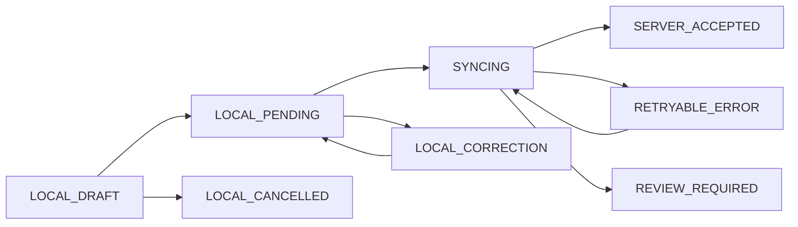

# Offline Sync — Proposed V1 Engineering Specification
**Status:** DESIGN DRAFT, not founder-approved technical contract. **Date:** 2026-10-28.

## Outcomes and constraints
Each authorized device has its **own** persistent transaction queue. Existing locally verifiable users can authenticate offline (verification method TBD). Cash, products and services supported in founder's latest request; noncash payment must use method-specific availability and verification states, NEVER automatic successful electronic capture.

## Local sale state proposal

A correction of locally committed sale is an append-only local cancellation/amendment event with reference to original; never silently erase a recorded cash movement. If local record was submitted, server resolves event order/idempotently.

## Minimal proposed local envelope
`tenant_id,business_id,branch_id,device_id,shift_id,operator_id,client_sale_id,local_sequence,occurred_at,created_at,payload_version,invoice_lines,payment_intents,payment_evidence,offline_auth_context,correction_events,content_hash,local_persisted_at`. Avoid storing payment card secrets. Client-supplied IDs and permissions are **claims**, validated on server.

## Sync protocol proposal
1. Durable write of event and unique `device_id+client_sale_id` before presenting saved receipt.
2. Device reconnects and authenticates to server; submit batched events in local order, keeping original IDs and hashes.
3. Server resolves account/scope, device registration, shift reference, timestamp bounds, catalog snapshots/prices, cancellation/version chain and tender evidence.
4. In transaction, claim unique idempotency key, enforce credit cap where permitted, produce one invoice/ledger/inventory/commission effect and append audit/outbox.
5. Server returns an immutable receipt mapping, acceptance status and reason codes. Retried batch/key returns same result; mismatched payload under same key requires security review.
6. Only delete/compact local events **after** durable server ack and retention policy; never drop unacknowledged sales.
7. Review queue for stock deficit, invalid authorization, mismatched tender, late period adjustment, stale shift or partially reconciled return.
8. Locally recorded cash sale with insufficient stock is accepted and flags reviewable shortage per earlier approved requirement; do not re-sell or duplicate charge.

## Distinguish tender states
`CASH_RECEIVED_LOCAL`, `EXTERNAL_TERMINAL_CONFIRMED_PENDING_RECONCILIATION`, `PROVIDER_CONFIRMATION_PENDING`, `PROVIDER_CONFIRMED`, `PROVIDER_FAILED`. This is a **proposed taxonomy**. Never label pending provider authorization PAID.

## Offline authentication security
Previous trusted online login + encrypted local credential verifier or device-bound secret (design pending), limited offline session lifetime, role/scope snapshot and last verified device registration; if server revokes a user while device is disconnected, immediate remote enforcement is impossible. Cap risk with expiry and reconcile unauthorized actions upon reconnect; do not promise instant revocation offline.

## Crash and data-loss handling
Use transactional durable local DB, forward-only log, integrity checksum, encryption at rest, clear pending counters and local export/recovery workflow. Device queue independent; cross-device aggregate totals are **not available** without connection. Full recovery of unsynced data after physical device loss cannot be guaranteed without a previously copied backup.

## Invariants and acceptance tests
- 20 repeats same event yield exactly one sale and one set of postings.
- Offline correction + original replay results in one coherent canonical outcome.
- Unauthorized or stale scope does not grant server access.
- Missing provider confirmation never creates a settled electronic payment.
- Two devices credit sales cannot violate global credit cap.
- Retryable sync failure persists local event and allows safe retry.
- Late arrival keeps occurred_at distinct from synced_at and posted_at.
- Failure recovery from app restart/device reconnect does not discard acknowledged or pending records.
- Stock shortage recorded and visible without dropping accepted sale.

## Open decisions
All payment method availability; offline invoices with pending payment; cached login lifetime; offline credit policy; allowed correction scope; batch ordering; pending shift/day closing; device replacement; approval thresholds; refund processing offline; exact API/DB schema.
