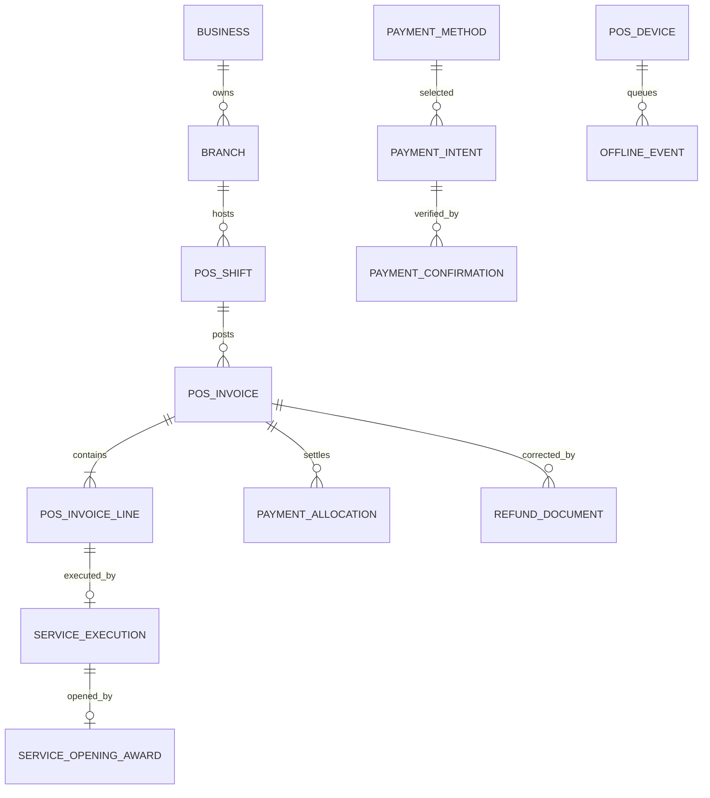

# POS Core — Logical Database Model V1 Draft

Status: engineering design, NOT a chosen SQL dialect or deployed schema. Date: 2026-10-29.

## Inherited founder-approved rules
Multi-Tenant, Business, Branch scoped; services + products same invoice; optional customer except credit; drafts; immutable posted invoices; split payments, payment method selectable online/offline; electronic settlement must be independently verified; hard credit limit; refund by item or amount; tips separate; shifts and provisional day closure; one executor, maximum one different opener earning 10% on post-discount pre-tax price; target belongs to executor; refunds reverse commissions. All records must preserve scope, dates and audit.

## Proposed normalized aggregates and cardinality
| Aggregate | Candidate tables | Essential references / integrity |
|---|---|---|
| Catalog | catalog_items, catalog_prices, branch_price_overrides | item type service/product; versioned prices, permitted branch override; sale captures immutable price snapshot |
| Draft | pos_drafts, pos_draft_lines | business, branch, shift context, optional customer, version; optimistic concurrency |
| Invoice | pos_invoices, pos_invoice_lines | unique invoice number within business+sequence policy TBD; one invoice many lines; original lines immutable after posting |
| Tender | payment_methods, payment_intents, payment_confirmations, payment_allocations | Business methods; separate selected vs confirmed; explicit payment state per tender; confirmation reference/source |
| Credit | customer_credit_accounts, receivable_entries, credit_limit_reservations | business-scoped customers, credit cap serialized transactionally for online sales; offline credit policy unresolved |
| Return | refund_documents, refund_lines, refund_allocations | one original invoice, many returns, amounts bounded against refundable balance; manager approvals |
| Treasury | branch_treasuries, pos_shifts, treasury_movements, cash_counts, cash_variances, variance_corrections | shared branch till and individual cashier shift; separate custody, source event, approved recoveries |
| Period | business_days, reconciliation_exceptions, device_loss_incidents | provisional and final lifecycle; occurred_at vs posting_at |
| Offline | pos_devices, offline_events, offline_acknowledgements | unique device/event pair, local sequence and hash; no duplicate postings |
| Salon | service_execution, service_opening_awards, commission_entries, target_entries | single executor, optional distinct opener, rate + calculation base snapshotted, unique source reference |
| HR | employee_ledger_entries | tips, earned commissions, refunds/reversals; not the POS source of truth |
| Integration | domain_events, outbox_messages, inbox_processed_events, audit_events | unique event id and consumer idempotency; append-only corrections |

## Suggested critical constraints
1. Composite scoped foreign keys or equivalent enforced tenant/business/branch ownership, never UI-only tenant filtering.
2. `UNIQUE(device_id, client_event_id)` + stored payload hash. Identical replay returns canonical outcome; conflicting replay quarantined.
3. `UNIQUE(source_event_id, consumer_name)` for each projector, no repeat inventory or commission posting.
4. Each line has a single executor if service and at most one opener different from executor. No double sale amount.
5. Never mutate posted invoice value/tax/cost; returns, corrections and reversal documents add separate rows.
6. Amounts and rounding use exact decimals or minor units; Business currency only. Final precision and tax rules remain unsettled.
7. Confirmed payment only with provider, verified terminal evidence or trustworthy settlement; selecting offline method remains possible regardless.
8. Cash received offline physically counted once even if its invoice syncs later.
9. Customer credit cannot exceed approved limit; cross-device offline credit enforcement still open, not assumed safe.

## Example relationship sketch

## Financial correctness checks
- Customer credit outstanding is recalculated from immutable journal/receivable entries, no blind balance overwrite.
- Provider-pending tender does not increase confirmed paid amount.
- Refund does not pay back more than confirmed payment; credit adjustments separately reduce AR.
- Use unique reservation/lock for concurrent cap checks; atomic outbox and invoice commit.
- Tip payable to employee, not service revenue or opener commission.
- Device lost before syncing: incident + manual cash reconciliation, not invented invoices.
- Final day close only after reconciled posted events or formally resolved exceptions; day close with open shift first provisional.
- Cross-business customer and staff relationships checked within the selected Business.

## Not finalized
SQL engine, ORM, indexes/partitions, invoice numbering, fiscal year, decimal precision, tax treatment, offline credit, refund allocation rounding, provider proof, cash custody handoffs, backups/recovery and accounting chart of accounts.
