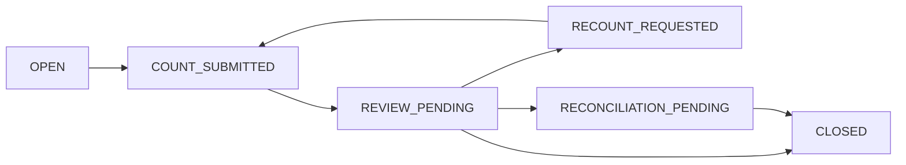

# Shift Closing & Day Settlement — Proposed Workflow
**Date:** 2026-10-28. **Status:** DESIGN DRAFT; finality rules NOT APPROVED.

## Confirmed
Branch treasury is shared, separate cashier shifts, business-configured allowed shift concurrency, physically counted cash, variance review by Manager, tips into Employee Ledger, shortages reviewed separately from employee payroll deduction, surplus to variance account before proven-sales reclassification, adjustments append-only, and day close with open shifts permitted WITH WARNING. Offline transactions reference original shift and source sale date.

## Proposed shift lifecycle

### Recommendation awaiting approval
Allow **provisional shift close** with unsynced offline events if cashier declares local pending count/value, device identity and physical cash count; mark shift reconciliation pending, lock new sales on that shift, and reopen only reconciliation ledger—not original shift or invoice. Final close only when all devices' relevant queues reconcile or Manager formally resolves documented exceptions. This is not yet a Founder decision.

## Shared cash-count complication
Per-cashier shift doesn't automatically yield individual accountable cash when a common till is open to multiple cashiers. Track handover chain and counted-by; last handover recipient is founder's selected reference but requires investigation evidence, not automatic liability.

## Proposed physical cash calculation
Expected cash = verified opening float + cash collections (including **known local offline cash movements for that till**) − cash refunds and withdrawals + transfers in/out. Split tender cash portion only. Pending card/provider intentions are excluded from cash count. For device queues inaccessible to closing supervisor, reconciliation remains pending and discrepancy is **not confirmed**.

## Proposed day-close lifecycle
`OPEN → CLOSED_WITH_PENDING_RECONCILIATION → RECONCILED` for warning-only close. Founder explicitly deferred whether closing is provisional or final; these names are a recommendation, not approval. Keep business date, occurred date, sync date and journal posting date; late sales create documented correction entries without editing original closed ledgers.

## Cash over/short correction
Manager can correct approved variance by new reversing/adjusting transaction referencing original, with reviewer, reason, evidence and event trail. Surplus cannot become fabricated sales. Shortage employee recovery requires separate consent/approval and labor law checks.

## Acceptance gates
No double counting of cash from synced vs unsynced transactions; inability to finalize reconciled status with unknown device queues; no duplicate correction on retry; credit and provider payments unverified remain unsettled; original source date preserved; day warning when shift open and late adjustment visible in accounting reports.

## Unresolved
Formal founder confirmation: provisional close, inclusion of offline cash counts, final financial-day accounting dates, device lost before sync, cross-device shift reconciliation, cash handover and multi-shift concurrency.

## Approved closing behavior — 2026-10-28

1. When offline transactions remain unsynced, **provisional shift close is allowed**; final settlement follows reconciliation. Cashier must not add new sales to that shift once provisionally closed (proposed enforcement detail).
2. **Physical cash count includes every cash amount actually received**, including offline sales not yet synchronized. Cash tender received is counted separately from provider-pending electronic tenders.
3. **Transient offline sync failure retries automatically**, with persistent unresolved problems shown to the Manager.
4. Electronic payment authorization during outages remains undecided.

### Recommended lifecycle (state identifiers proposed)

`OPEN → COUNT_SUBMITTED → PROVISIONALLY_CLOSED → RECONCILIATION_PENDING → CLOSED_FINAL`. `RECOUNT_REQUIRED` can return to `COUNT_SUBMITTED`; failed sync stays in reconciliation pending until acknowledged or exception resolved with a documented adjustment. Distinguish **cash physically held** from **cash digitally acknowledged by server**. Final closing must aggregate local cash events once and verify all device queues associated with this shift. Shared treasury with independent cashier shifts requires custody evidence; differences are not automatically lawful salary deductions.

### Worked example

Opening float 500; synced cash sales 800; offline unsynced cash sales 300; verified cash withdrawals 100. Expected physical cash = 500 + 800 + 300 − 100 = **1,500**. If actual count 1,480, provisional shortage is 20; Manager reviews it. On later sync, 300 must not be added *again* to physical cash count. If a queued event fails permanently, handle through exception reconciliation rather than silently deleting event.

### Day closing remains separate

Earlier approval to close a financial day with open shifts *with warning* still stands. Provisional shift closure does **not** by itself decide whether business-day closure is provisional or final. Late sale should keep original occurrence date and be documented through posting-period adjustment, pending Accounting policy.
