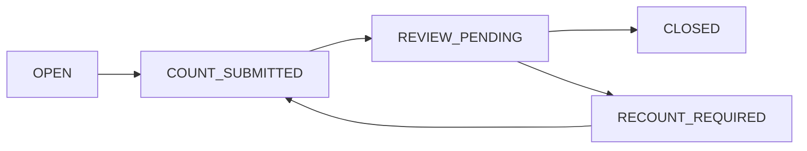

# Shift Lifecycle & Cash Reconciliation — V1 Design Draft

**Date:** 2026-10-28
**Status:** Proposed implementation specification; open choices are NOT implicitly approved.

## Confirmed founder requirements

- Shared branch treasury with a separate cashier shift.
- Each sale requires an open shift. Business setting controls whether one cashier may have multiple open shifts.
- Cashier enters physically counted cash upon closure; system computes shortage or surplus.
- Manager reviews cash variance. Shortage is registered against responsible last cash custodian but **requires separate approval before employee deduction**.
- Cash surplus initially posted to cash variance account, reclassified as sales **only after verified evidence** (latest founder approval supersedes previous immediate-sales request).
- Approved cash-variance settlement corrections are made using a new auditable correction while preserving original.
- Offline cash sale uses the **same shift** and retains original occurrence date; later sync may require documented day adjustment.
- Financial day may close with open shifts, with warning; provisional/final settlement policy not yet decided.
- Tips recorded in Employee Ledger.

## Shift states — engineering proposal

Exceptional state `RECONCILIATION_PENDING` is proposed if offline cash sales are unsynced or financial day has closed. Whether actual close may proceed in this state is open.

## Cash custody is separate from Shift

Shared treasury does not guarantee individual cash attribution. Record explicit handover events (from-user, to-user, timestamp, expected/actual cash, verification, note). Founder chose last employee receiving custody as responsibility reference, but investigate concurrent access; never assume the employee owes money absent reviewed evidence and required lawful authorization.

## Reconciliation design proposal

1. Identify opening float and cash movements per treasury/shift/device.
2. Calculate expected cash = opening float + cash collections − refunds paid in cash ± recorded authorized cash moves.
3. Cashier submits physical counted amount and notes. Preserve first submission.
4. Variance = counted − expected; create immutable variance record assigned to custody chain.
5. Manager reviews with reason and evidence, then posts approved accounting treatment.
6. Shortage recovery and employee payroll deduction are **distinct approvals**.
7. Surplus goes to cash over/short pending classification; only verified sales evidence permits proper sale posting (never fabricate an invoice merely to balance cash).
8. Correct approved posting through linked reversing/reclassification entry, not in-place edits.
9. Preserve late offline sales and reconciliation delta; don't rewrite closed posted history.

## Business-day closure—requirements vs proposal

Founder approves warning-only **permission to close a business day while shifts are still open**. There is NO approved decision whether this is a provisional close or a final close with later adjustment. Recommend provisional close until late shifts and offline cash sales reconcile, then permanent close with auditable period adjustments. This recommendation needs confirmation.

## Commands and candidate event contracts (not yet approved)

`OpenShift`, `SubmitCashCount`, `ReviewVariance`, `ApproveEmployeeRecovery`, `CloseShift`, `TransferCashCustody`, `CloseBusinessDay`, `PostLateOfflineAdjustment`; corresponding append-only audit events and version checks.

## Acceptance tests to specify

- Two cashiers share branch treasury but maintain distinct shift-ledger entries; custody ambiguity surfaced.
- Repeat close/review request does not double-book variance or deduction.
- Denied payroll deduction when only variance review exists.
- Cash surplus not counted as revenue without confirmed source sale.
- Offline sale sync after day close retains occurred_at, synced_at and correctly posted adjustment.
- Multiple open shifts obey Business setting.
- Closing day with open shift records warning and review obligation.
- Cross-tenant/cross-branch shifts/cash movements blocked.

## Unresolved

Day finality; closing shifts with pending offline sales; cash custody handovers and multi-shift overlap; accounting accounts; handling of withdrawals/transfers; employee-deduction law/compliance; timezone and late-posting policy.
